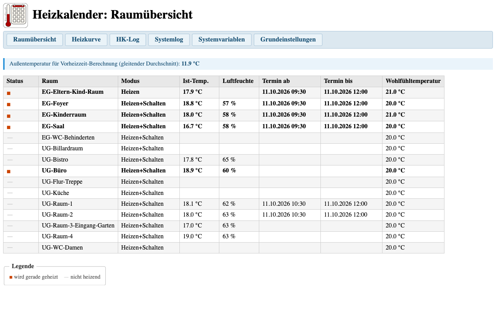

# Heizkalender Addon: Anwenderhandbuch

## Inhalt

- [Überblick](#überblick)
- [Voraussetzungen](#voraussetzungen)
- [Installation](#installation)
- [Raumübersicht](#raumübersicht)
- [Heizkurvenkontrolle](#heizkurvenkontrolle)
- [HK-Log](#hk-log)
- [Systemlog](#systemlog)
- [Systemvariablen](#systemvariablen)
- [Grundeinstellungen](#grundeinstellungen)

---

## Überblick

Das Heizkalender Addon stellt eine Weboberfläche auf der CCU bereit, über die der laufende Betrieb des Heizkalenders beobachtet werden kann. Die Oberfläche ist über den Browser erreichbar und erfordert keine zusätzliche Software.

Die Oberfläche ist grundlegend responsiv gestaltet (Navigation bricht um, Tabellen scrollen horizontal). Eine vollständige Optimierung für Mobilgeräte ist jedoch nicht möglich, da die Tabellen mit ihren vielen Spalten auch auf kleinen Displays eine gewisse Mindestbreite benötigen.

Die Startseite des Addons ist über die CCU-Weboberfläche unter **Einstellungen > Zusatzsoftware > Heizkalender > Einstellungen** erreichbar, oder direkt unter:

```link
http://<IP-der-CCU>/addons/heizkalender/
```

---

## Voraussetzungen

- HomeMatic CCU3 oder RaspberryMatic
- Heizkalender-Skripte (Skript 1 und Skript 2) eingerichtet und aktiv
- Für HK-Log und Heizkurvenkontrolle: USB-Stick an der CCU angeschlossen, auf dem die Logdateien gespeichert werden (`HK-SystemProtokoll sichern.hsc` muss als Programm eingerichtet sein)

---

## Installation

Das Addon wird über die CCU-Weboberfläche installiert:

1. Unter **Einstellungen > Zusatzsoftware** auf **Installieren** klicken.
2. Die Datei `heizkalender-addon.tar.gz` auswählen und hochladen.
3. Die CCU startet nach der Installation neu.

Nach dem Neustart erscheint der Heizkalender in der Liste der installierten Zusatzsoftware.

---

## Raumübersicht

**Erreichbar unter:** `/addons/heizkalender/index.cgi`

Die Raumübersicht zeigt für jeden konfigurierten Raum den aktuellen Heizstatus auf einen Blick.


| Spalte | Bedeutung |
| ------ | --------- |
| Status | Symbol für den aktuellen Zustand (siehe Legende) |
| Raum | Name des Raums (aus der Raum-Systemvariablen `HKG-Raum-*`) |
| Modus | Heizmodus: Heizen, Schalten oder Heizen+Schalten |
| Ist-Temp. | Aktuelle Raumtemperatur (wenn ein Sensor zugeordnet ist) |
| Luftfeuchte | Aktuelle Luftfeuchtigkeit (wenn der Sensor diesen Wert liefert) |
| Termin ab | Beginn des nächsten oder laufenden Termins aus der Schaltliste |
| Termin bis | Ende des Termins aus der Schaltliste |
| Wohlfühltemperatur | Zieltemperatur für den Raum |

**Statussymbole (Legende):**

- Gefülltes Quadrat (rot): Raum wird gerade geheizt
- Gedankenstrich (hellgrau): Raum heizt nicht

**Statusermittlung:** Das Statussymbol wird direkt aus Feld 0 der jeweiligen `HKG-Raum-*`-Systemvariablen gelesen (0 = nicht heizend, 1 = heizt). Die Spalten „Termin ab" und „Termin bis" zeigen die Zeiten aus der Schaltliste (`HK1-Schaltliste`).

Ganz oben wird, falls vorhanden, die aktuelle Außentemperatur (gleitender Mittelwert) angezeigt, die für die Vorheizzeitberechnung verwendet wird.

**Hinweis:** Die Seite zeigt ausschließlich Heizdaten. Der ursprüngliche Terminname aus dem Kalender ist in der Schaltliste nicht enthalten.

Hier liegt ein Sonderfall vor: Der Raum *UG-Büro* wurde dem Raum *EG-Eltern-Kind-Raum* zugewiesen, sodass sie eine Raumgruppe bilden. Entsprechend wird der Raum *UG-Büro* mitgeheizt. Der Termin enthält allerdings nur den Raum *EG-Eltern-Kind-Raum*.



---

## Heizkurvenkontrolle

**Erreichbar unter:** `/addons/heizkalender/hkkurve.cgi`

Die Heizkurvenkontrolle wertet die aufgezeichneten Heizereignisse aus dem USB-Stick-Archiv aus und zeigt, wie gut die Heizung die gewünschte Temperatur zum Terminbeginn erreicht hat.


**Voraussetzung:** USB-Stick mit HK-Log-Dateien (siehe [HK-Log](#hk-log)).

**Filter:**

| Filter | Bedeutung |
| ------ | --------- |
| Zeitraum | Heute (Standard), letzte 7 Tage, letzte 30 Tage oder letzte 90 Tage |
| Raum | Alle Räume oder ein bestimmter Raum (inkl. Gruppenräume) |
| Ereignis | Alle Ereignisse (Standard) oder ein bestimmter Typ |

Nach Auswahl der Filter auf **Anzeigen** klicken. Die Seite lädt erst dann Daten.

**Ereignistypen und ihre Bedeutung (Zeilenfarben):**

| Farbe | Ereignis | Bedeutung |
| ----- | -------- | --------- |
| Blau | Heizbeginn (rechtzeitig) | Heizung startete vor dem Terminbeginn |
| Orange | Heizbeginn (zu spät) | Heizung startete erst nach dem Terminbeginn |
| Grün (hell) | Terminbeginn | Ist-Temperatur zum Zeitpunkt des Terminbeginns |
| Grün | Zieltemperatur | Zieltemperatur wurde während des Termins erreicht |
| Gelb | Terminende | Ist-Temperatur zum Zeitpunkt des Terminendes |
| Grau | Heizende | Heizung hat abgeschaltet |
| Rot | Fehler | Fehler oder kein Sensor vorhanden |

Die Spalte **Δ min** gibt an, wie viele Minuten vor (negativ) oder nach (positiv) dem Terminbeginn das Ereignis eingetreten ist.

**Indikatoren in der Spalte „Ist-Temp.":**

In den Zeilen *Zieltemperatur* und *Terminbeginn* erscheint neben der Temperatur ein farbiges Symbol:

| Symbol | Farbe | Bedeutung |
| ------ | ----- | --------- |
| ▲ | Grün | Zieltemperatur zum Terminbeginn erreicht (Zieltemperatur-Zeile: vor Terminbeginn erreicht) |
| ▼ | Rot | Zieltemperatur zum Terminbeginn noch nicht erreicht (Zieltemperatur-Zeile: erst nach Terminbeginn erreicht) |

---

## HK-Log

**Erreichbar unter:** `/addons/heizkalender/hklog.cgi`

Das HK-Log zeigt die auf dem USB-Stick archivierten Protokolleinträge des Heizkalenders. Die Einträge werden aus den tages- oder wochenweisen Logdateien gelesen, die `HK-SystemProtokoll sichern.hsc` auf den USB-Stick schreibt.


**Voraussetzung:** USB-Stick an der CCU angeschlossen, Logdateien vorhanden (`HK-Log_JJJJ-MM-TT.log`). Es werden Dateien der letzten 60 Tage angezeigt.

**Zeitstempel-Format:** `JJJJ-MM-TT HH:MM:SS` (aus der CCU-Historiendatenbank).

**Filter:**

| Filter | Bedeutung |
| ------ | --------- |
| Filter | Alle Einträge oder nur eine Quelle (HK1, HK2, Heizkurvenkontrolle, HK-Log, Nachtabschaltung) |
| Log-Datei | Auswahl der Tagesdatei |
| Letzte Zeilen | Anzahl der angezeigten Zeilen (Standard: 50, max. 5000) |

Die Anzeige entspricht einem `tail`: die letzten N Zeilen der Datei, älteste oben, neueste unten.

Über den **Download**-Link kann die gewählte Logdatei heruntergeladen werden.

---

## Systemlog

**Erreichbar unter:** `/addons/heizkalender/syslog.cgi`

Das Systemlog zeigt die letzten Einträge aus dem Linux-Systemprotokoll der CCU (`/var/log/messages`).


**Zeitstempel-Format:** `Mmm DD HH:MM:SS` (Linux-Syslog-Format, ohne Jahreszahl).

**Filter:**

| Filter | Bedeutung |
| ------ | --------- |
| Nur Heizkalender | Zeigt nur Zeilen mit Bezug zum Heizkalender |
| Letzte Zeilen | Anzahl der angezeigten Zeilen (Standard: 50, max. 2000) |

Die Anzeige entspricht einem `tail`: älteste Zeilen oben, neueste unten.

**Hinweis:** Das Systemprotokoll ist flüchtig. Es überlebt keinen CCU-Neustart und wird bei vollem Speicher automatisch gekürzt. Für eine dauerhafte Aufzeichnung ist `HK-SystemProtokoll sichern.hsc` zuständig.

---

## Systemvariablen

**Erreichbar unter:** `/addons/heizkalender/sysvars.cgi`

Die Seite zeigt alle Systemvariablen des Heizkalenders mit ihrem aktuellen Wert und einer kurzen Beschreibung. Die Variablen sind nach Präfix gruppiert:


| Abschnitt | Präfix | Inhalt |
| --------- | ------ | ------ |
| Allgemein | `HK-*` | Logging-Flags und Log-Variablen |
| Kalender | `HK1-*` | Variablen für Skript 1 (Termineinlesen) |
| Schalten | `HK2-*` | Variablen für Skript 2 (Schalten und Heizen) |
| Räume | `HKG-Raum-*` | Individuelle Raumkonfigurationen |

Die Seite ist rein lesend. Werte können nur direkt in der CCU-Weboberfläche geändert werden.

---

## Grundeinstellungen

**Erreichbar unter:** `/addons/heizkalender/hkconfig.cgi`

Die Seite zeigt die wichtigsten Einstellungen des Heizkalenders in aufbereiteter Form: Logging-Flags, Kurveneinstellungen und eine Übersicht aller Raumkonfigurationen. Die Abschnitte entsprechen 1:1 den Seiten des Windows-Installers und dienen als Nachschlagewerk, wenn man gerade nicht am passenden PC sitzt oder remote auf die CCU zugreift.


Die Seite ist rein lesend. Änderungen werden über den Installer vorgenommen.
