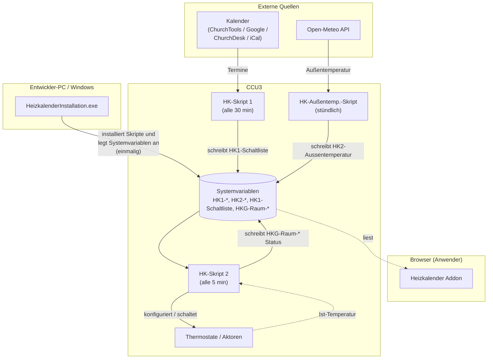
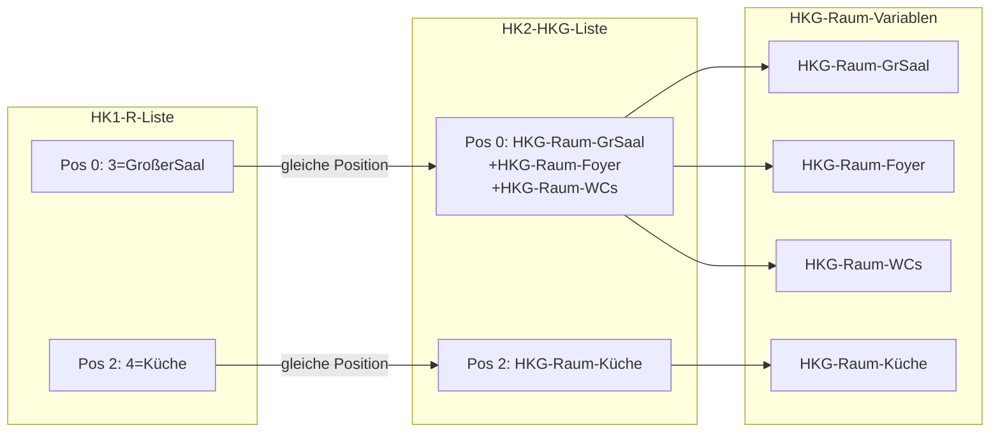

# Entwickler-Dokumentation

Diese Seite richtet sich an Mitwirkende, die am Code des Heizkalenders arbeiten:
an den HomeMatic-Skripten oder am Windows-Installations-Programm.

## Inhalt

- [Architektur-Überblick](#architektur-überblick)
- [Systemvariablen-Formate](#systemvariablen-formate)
- [Skript-Syntax (HomeMatic HSC)](#skript-syntax-homematic-hsc)
- [Build des Installers (Windows, Visual Studio)](#build-der-heizkalenderinstallationexe-windows-visual-studio)
- [Versionierung](#versionierung)
- [Änderungs-Workflow](#änderungs-workflow)
- [Heizkalender Addon](#heizkalender-addon)

## Architektur-Überblick

Der Heizkalender besteht aus drei Teilen:

1. **HomeMatic-Skripte** (`.hsc`-Dateien), die direkt auf der CCU laufen.
2. **HeizkalenderInstallation**, eine Windows-MFC-Anwendung (C++/Win32) zum
   Einrichten und Aktualisieren der Skripte und Systemvariablen auf der CCU.
3. **Heizkalender Addon**, eine optionale Web-Oberfläche, die als CCU-Addon
   installiert wird und Statusanzeige, Log-Auswertung und Grundeinstellungen
   direkt im Browser bietet.



Die Skripte kommunizieren ausschließlich über **Systemvariablen** auf der CCU.
Der Laufzeit-Ablauf:

1. Eine **Skript-1-Variante** liest Termine aus einer externen Quelle
   (ChurchTools, ChurchDesk, iCal oder Google) und schreibt sie in die
   Systemvariable `HK1-Schaltliste`.
2. **HK-Skript 2** läuft alle 5 Minuten, liest `HK1-Schaltliste` und schaltet die
   Thermostate entsprechend.
3. Das **Addon** liest dieselben Systemvariablen lesend aus und stellt sie im
   Browser dar; es schreibt nichts in die Skript-Variablen zurück.

Es wird immer nur eine Skript-1-Variante eingesetzt. Alle Skripte eines
Release-Standes gehören zusammen und müssen gemeinsam eingespielt werden.

## Systemvariablen-Formate

Die vier zentralen Schnittstellenvariablen haben ein festgelegtes Textformat.
Änderungen am Format erfordern immer eine gleichzeitige Anpassung aller
Skripte, die diese Variable lesen oder schreiben, sowie des Addons, das die
Variablen für die Anzeige im Browser parst.

### HK1-R-Liste

Ordnet jeder Kalender-Ressource einen lesbaren Namen zu. Skript 1 schreibt
diese Variable; Skript 2 und der Installer lesen sie.

```txt
ID1[=Name1];ID2[=Name2];...
```

| Feld | Inhalt |
| :--- | :--- |
| ID | Numerische Ressourcen-ID aus dem Kalendersystem |
| Name | Optionaler Klarname, getrennt durch `=` |

Trennzeichen zwischen Einträgen: `;`. Der Name-Teil kann entfallen; dann steht
nur die ID.

Beispiel: `16=Gr. Saal;17=Kl. Saal;18`

### HK2-HKG-Liste

Ordnet jeder Ressource aus `HK1-R-Liste` eine oder mehrere Raum-Systemvariablen zu.
Die Reihenfolge der Einträge entspricht der Reihenfolge in `HK1-R-Liste`.

Über das `+`-Zeichen lassen sich Räume zu einer Gruppe zusammenschalten: wird die
Ressource gebucht, heizt HK-Skript 2 automatisch alle Räume der Gruppe. So kann
z.B. bei einer Buchung des Großen Saals gleichzeitig das Foyer und das Gäste-WC
mitgeheizt werden, ohne dass dafür separate Kalendereinträge nötig sind.

```txt
HKG-Raum-A[+HKG-Raum-B];HKG-Raum-C;...
```

| Trennzeichen | Bedeutung |
| :--- | :--- |
| `;` | Trennt Einträge (je einer pro Ressource) |
| `+` | Verbindet mehrere Raum-Systemvariablen zu einer gemeinsam geschalteten Gruppe |

Beispiel: `HKG-Raum-GrSaal+HKG-Raum-Foyer+HKG-Raum-GaesteWC;HKG-Raum-KlSaal`

**Wichtig:** Die Verknüpfung zwischen `HK1-R-Liste` und `HK2-HKG-Liste` ist rein positionsbasiert.
Skript 1 sucht die ResID in `HK1-R-Liste`, merkt sich den Index und liest an gleicher Position
in `HK2-HKG-Liste` nach. Beide Listen müssen daher immer gleich viele Einträge haben und
in identischer Reihenfolge gepflegt werden.



### HKG-Raum-*

Jeder Raum hat eine eigene Systemvariable `HKG-Raum-<Name>`. Der Wert ist
eine semikolongetrennte Liste mit sechs Pflichtfeldern und einem optionalen
siebten Feld:

```txt
Status;Modus;Heiztyp;Wohlfühltemp[/Grundtemp];Vorheizzeit[*Faktor];VorzeitAus[;Thermostat[;Schaltaktor1[;Schaltaktor2...]]]
```

| Feld | Index | Typ | Werte |
| :--- | :---: | :--- | :--- |
| Status | 0 | Integer | `0` = keine Heizphase, `1` = Heizphase aktiv |
| Modus | 1 | String | `H` = Heizen, `S` = Schalten, `HS` = Heizen + Schalten |
| Heiztyp | 2 | String | `IP`, `RT`, `TC`, `IT` (Thermostate), `SW` (Schalt-Aktor) |
| Wohlfühltemp | 3 | Float | Zieltemperatur in °C; optional `/Grundtemp` für raumindividuelle Grundtemperatur |
| Vorheizzeit | 4 | Integer | Individuelle Vorheizzeit in Minuten; optional `*Faktor` (Float, 0,20–5,0) |
| VorzeitAus | 5 | Integer | Minuten vor Terminende, nach denen abgeschaltet wird |
| Thermostat | 6 | String | Nur bei Modus `HS`: CCU-Kanaladresse des Thermostats, der als Temperatursensor dient |
| Schaltaktor(en) | 7+ | String | Nur bei Modus `HS`: CCU-Kanaladdresse(n) der Schaltaktoren; mehrere Aktoren werden durch weitere `;`-Felder angehängt |

Trennzeichen innerhalb eines Wertes:

| Zeichen | Bedeutung |
| :--- | :--- |
| `;` | Trennt die Felder voneinander; bei Modus `HS` auch die Schaltaktoren (Felder 7+) |
| `/` | Trennt Wohlfühltemperatur und Grundtemperatur (im Feld Wohlfühltemp) |
| `*` | Trennt Vorheizzeit und Faktor (im Feld Vorheizzeit) |

Beispiele:

- `0;H;IP;18;0;30` — Heizmodus, HmIP-Thermostat, 18 °C, keine individuelle Vorheizzeit, 30 min vor Terminende aus
- `0;H;IP;21/16;60*1.5;30` — wie oben, aber 21 °C Wohlfühltemperatur, 16 °C Grundtemperatur, 60 min Vorheizzeit mit Faktor 1,5
- `0;HS;SW;21;0;30;BidCoS-RF.ABC12345:1;BidCoS-RF.DEF67890:1` — Heizen + Schalten, Thermostat an Feld 6, ein Schaltaktor an Feld 7

### HK1-Schaltliste

Übergabepuffer von Skript 1 an Skript 2. Wird automatisch befüllt und
ausgelesen; niemals manuell verändern.

Mehrere Einträge stehen direkt hintereinander ohne zusätzliches Trennzeichen;
jeder Eintrag besteht aus fünf semikolongetrennten Feldern:

```txt
RessourcenID;Startzeit;Endezeit;Steuerung;ModusRessourcenID;Startzeit;...
```

| Feld | Typ | Inhalt |
| :--- | :--- | :--- |
| RessourcenID | Integer | Ressourcen-ID (gemäß `HK1-R-Liste`) |
| Startzeit | Integer | UNIX-Timestamp (UTC) des Terminbeginns |
| Endezeit | Integer | UNIX-Timestamp (UTC) des Terminendes |
| Steuerung | Integer | Steuerungswert aus dem Termintext: `0` = normal, `-1` = `#EIN#`, `-2` = `#AUS#`, `-3` = `#RESET#`, positive Zahl = Minuten aus `#<Zahl>#` |
| Modus | String | `§` = Heizen, `&` = Schalten |

Trennzeichen:

| Zeichen | Bedeutung |
| :--- | :--- |
| `;` | Trennt die Felder innerhalb eines Eintrags |
| (keines) | Einträge folgen direkt aufeinander; der Modus-Wert des vorherigen Eintrags grenzt unmittelbar an die RessourcenID des nächsten |

Beispiele:

- Ein Eintrag: `17;1720951200;1720954800;0;§` (Ressource 17, 14.07.2024 12–13 Uhr, Heizmodus)
- Zwei Einträge hintereinander: `17;1720951200;1720954800;0;§16;1720951200;1720958400;0;&` (Ressource 17 heizen, Ressource 16 schalten, gleicher Startzeitpunkt)

### HK2-Kurve

Acht semikolongetrennte Ganzzahlen (Vorheizzeiten in Minuten) für die festen
Außentemperatur-Stützpunkte −10, −5, 0, 8, 10, 12, 15, 17,5 °C.

```txt
V1;V2;V3;V4;V5;V6;V7;V8
```

Zwischen den Stützpunkten interpoliert HK-Skript 2 linear. Der erste Wert
(tiefste Außentemperatur) ist die längste Vorheizzeit. Installer-Default:
`162;130;100;59;50;41;30;20`.

Beispielkurven und Berechnungshintergrund:
[Anwenderhandbuch](Anwenderhandbuch.md#die-heizkurve-hk2-kurve),
[Heizsteuerung-Vorheizzeit.md](../Skripte/Dokumentation/Heizsteuerung-Vorheizzeit.md)

## Skript-Syntax (HomeMatic HSC)

- Kommentarzeichen ist `!`. Für die Editor-Syntaxhervorhebung wird zusätzlich ein
  C-Kommentar gesetzt, daher die kombinierte Form `!//`.
- Stringverkettung erfolgt mit `#` statt `+`.
- `break` und `continue` werden unterstützt (CCU3/RaspberryMatic, nicht CCU2).
- Sonderbefehle in Termintexten: `#EIN#`, `#AUS#`, `#RESET#`, `#GT#`, `#NS#`,
  `#NH#`, `#<Zahl><Text>#` (siehe
  [Anwenderhandbuch](Anwenderhandbuch.md#sonderbefehle-in-terminen)).

Die Dateiendung `.hsc` ist eine bewusste Wahl (siehe
[Skripte/Readme.md](../Skripte/Readme.md)); historisch wurde `.c` verwendet.

## Build der `HeizkalenderInstallation.exe` (Windows, Visual Studio)

Das Installations-Projekt liegt in `HeizkalenderInstallation/`:

- Projektdatei: `HeizkalenderInstallation.vcxproj`
- Solution: `HeizkalenderInstallation.slnx`
- Zielplattform: Windows 10+, Win32/x64, MFC Unicode
- Konfigurationen: Debug/Release × Win32/x64

Es gibt keine Makefiles oder Build-Skripte für macOS/Linux; die `HeizkalenderInstallation.exe` ist
rein Windows-seitig.

Wichtige Klassen:

- `CPropertySheet` + `CPageBase`-Ableitungen: mehrseitiger Wizard (Connect, Räume,
  Ressourcen, Systemvariablen)
- `CScriptEngine`: führt HomeMatic-Skripte auf der CCU aus (HTTP POST)
- `CWGetEngine`: HTTP-Client (WinINet)
- `CData` / `TDataList<>`: Modell für Systemvariablen und Skripteinträge

## Versionierung

Es gibt keine Versionsnummern in den Dateinamen. Der Stand jedes Skriptes steht
als Datum im Datei-Header (`!// Stand:`). Kompatible Skripte finden sich immer in
einem GitHub-Release mit demselben Datums-Tag (`vJJJJ-MM-TT`).

Die Änderungshistorie über alle Stände hinweg steht im zentralen
[CHANGELOG.md](../CHANGELOG.md).

## Änderungs-Workflow

Wird eine `.hsc`-Datei (oder `HeizkalenderInstallation.exe`-Quelle) inhaltlich geändert, gehören dazu
immer die folgenden Schritte:

1. **Stand aktualisieren:** Datum in der `!// Stand:`-Zeile im Datei-Header auf das
   aktuelle Datum setzen.
2. **Changelog im Header fortschreiben:** Neuen `!// MRi: JJJJ-MM-TT`-Eintrag ganz
   oben in den Changelog-Block des Headers einfügen (neueste Einträge oben). Kurz
   beschreiben, *was* und *warum* geändert wurde.
3. **Zentrales [CHANGELOG.md](../CHANGELOG.md) fortschreiben:** Eintrag unter dem
   passenden Datums-Stand ergänzen (Keep-a-Changelog-Format, Kategorien
   Hinzugefügt/Geändert/Behoben/Entfernt).
4. **Dokumentation prüfen:** Neue oder umbenannte Systemvariablen müssen in der
   [Skript-Referenz](../Skripte/Dokumentation/Readme.md) erscheinen.
5. **`HeizkalenderInstallation.exe` anpassen (nur bei neuen/geänderten Systemvariablen):** Die
   `HeizkalenderInstallation.exe`
   liest die Systemvariablen NICHT aus den `.hsc`-Dateien, sondern legt sie über
   eigene, fest einkompilierte Meta-Skripte an
   (`HeizkalenderInstallation/res/SYSVARS_Init_*.hsc` sowie `SYSVARS-Init.hsc` /
   `SYSVARS-InitValues.txt`). Wird eine neue Systemvariable eingeführt, umbenannt
   oder ihr Default geändert, muss sie dort von Hand ergänzt werden, sonst legt
   die `HeizkalenderInstallation.exe` sie nicht an.

**Konsistenz-Hinweis Systemvariablen:** Werden Variablen in den
`HK-Init-Skript 1_*.hsc` über die parallelen Arrays (`nm`/`be`/`tp`/`vl`/`vu`/`wr`/`pr`)
angelegt, muss jeder neue Eintrag in ALLEN Arrays an gleicher Index-Position
stehen. Beschreibungstexte (`be`) dürfen KEIN Semikolon enthalten, da es als
Array-Trenner interpretiert wird.

## Heizkalender Addon

Das Heizkalender Addon ist eine eigenständige Komponente mit eigener Entwicklerdokumentation.
Sie beschreibt Verzeichnisstruktur, Paketformat, rc.d-Script, CGI-Seiten und die
Besonderheiten von Tcl 8.2 auf der CCU3.

Vollständige Dokumentation: [Addon/docs/Entwickler.md](../Addon/docs/Entwickler.md)
