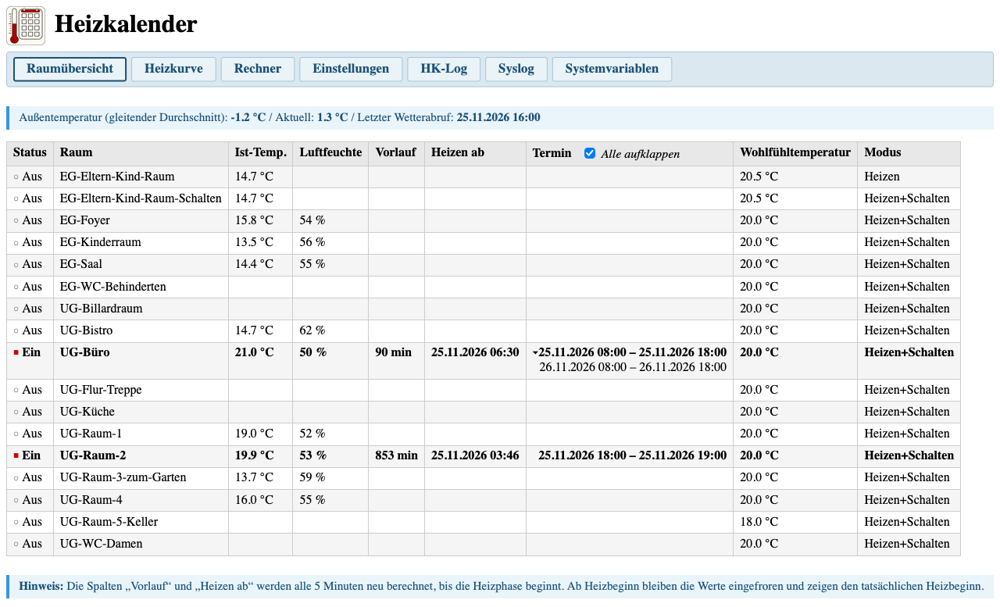
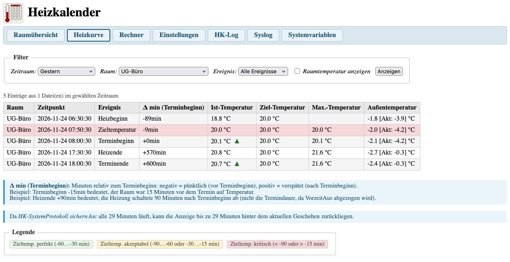
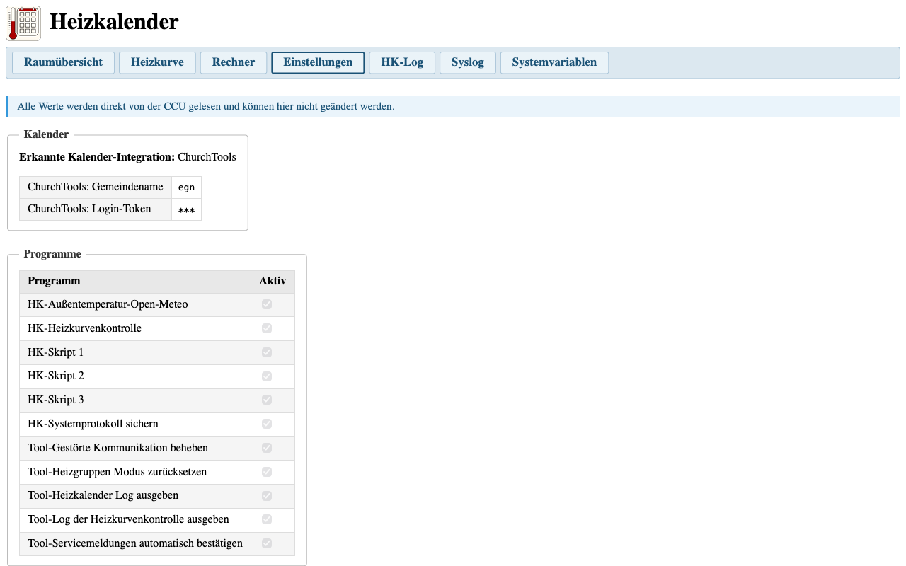
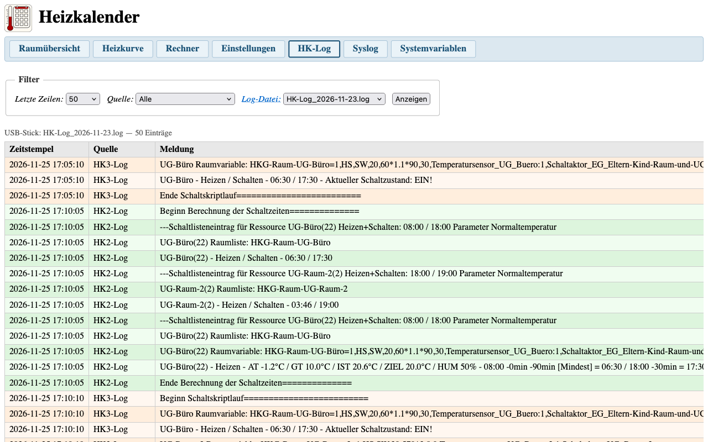
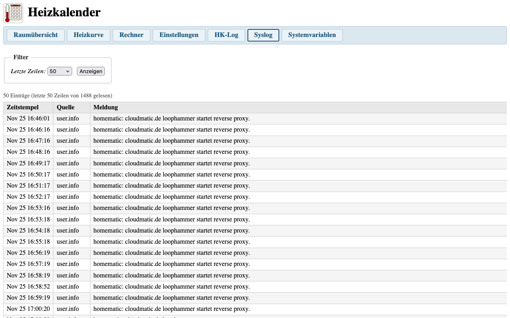
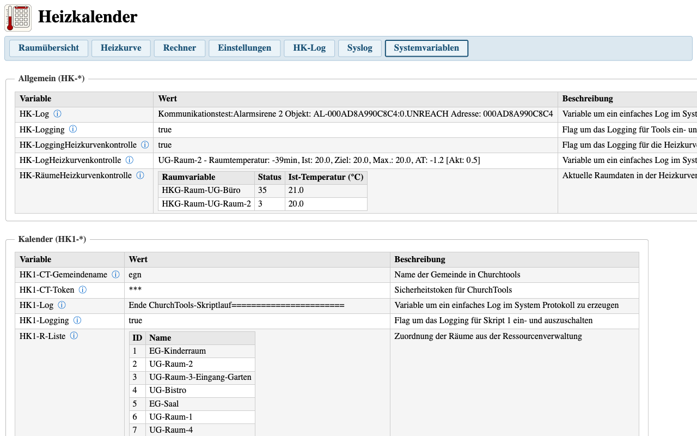

# Heizkalender Addon: Anwenderhandbuch

## Überblick

Das Heizkalender Addon stellt eine Weboberfläche auf der CCU bereit, über die der laufende Betrieb des Heizkalenders beobachtet werden kann. Die Oberfläche ist über den Browser erreichbar und erfordert keine zusätzliche Software.

Die Oberfläche ist grundlegend responsiv gestaltet (Navigation bricht um, Tabellen scrollen horizontal). Eine vollständige Optimierung für Mobilgeräte ist jedoch nicht möglich, da die Tabellen mit ihren vielen Spalten auch auf kleinen Displays eine gewisse Mindestbreite benötigen.

Die Startseite des Addons ist über die CCU-Weboberfläche unter **Einstellungen > Zusatzsoftware > Heizkalender > Einstellungen** erreichbar, oder direkt unter:

```link
http://<IP-der-CCU>/addons/heizkalender/
```

---

## Voraussetzungen

- HomeMatic CCU3 oder RaspberryMatic
- Heizkalender-Skripte (Skript 1 und Skript 2) eingerichtet und aktiv
- Für HK-Log und Heizkurvenkontrolle: USB-Stick an der CCU angeschlossen, auf dem die Logdateien gespeichert werden (`HK-SystemProtokoll sichern.hsc` muss als Programm eingerichtet sein)

---

## Installation

Das Addon wird über die CCU-Weboberfläche installiert:

1. Unter **Einstellungen > Zusatzsoftware** auf **Installieren** klicken.
2. Die Datei `heizkalender-addon.tar.gz` auswählen und hochladen.
3. Die CCU startet nach der Installation neu.

Nach dem Neustart erscheint der Heizkalender in der Liste der installierten Zusatzsoftware.

---

## Raumübersicht

**Erreichbar unter:** `/addons/heizkalender/index.cgi`

Die Raumübersicht zeigt für jeden konfigurierten Raum den aktuellen Heizstatus auf einen Blick.



| Spalte | Bedeutung |
| ------ | --------- |
| Status | `Ein`, `Aus`, `Dauer-Ein` oder `Dauer-Aus` entsprechend dem Schaltzustand |
| Raum | Name des Raums (aus der Raum-Systemvariablen `HKG-Raum-*`) |
| Modus | Heizmodus: Heizen, Schalten oder Heizen+Schalten |
| Ist-Temp. | Aktuelle Raumtemperatur (wenn ein Sensor zugeordnet ist) |
| Luftfeuchte | Aktuelle Luftfeuchtigkeit (wenn der Sensor diesen Wert liefert) |
| Vorlauf | Berechnete Vorheizzeit in Minuten (nur wenn `HK2-Schaltzeiten` vorhanden) |
| Heizen ab | Berechneter Einschaltzeitpunkt (nur wenn `HK2-Schaltzeiten` vorhanden) |
| Termin | Beginn und Ende des nächsten oder laufenden Termins aus der Schaltliste; bei mehreren Terminen aufklappbar |
| Wohlfühltemperatur | Zieltemperatur für den Raum |

Die Spalten **Vorlauf** und **Heizen ab** werden nur angezeigt, wenn die Systemvariable `HK2-Schaltzeiten` auf der CCU vorhanden ist. Ist sie nicht angelegt, entfallen diese beiden Spalten.

**Statusermittlung:** Der Status wird direkt aus Feld 0 der jeweiligen `HKG-Raum-*`-Systemvariablen gelesen (0 = `Aus`, 1 = `Ein`, 2 = `Dauer-Aus`, 3 = `Dauer-Ein`). `Ein` und `Dauer-Ein` werden aktiv hervorgehoben. Andere Statuswerte erscheinen als `Unbekannt`. Die Spalte „Termin" zeigen die Zeiten aus der Schaltliste (`HK1-Schaltliste`).

Ganz oben wird, falls vorhanden, die aktuelle Außentemperatur (gleitender Mittelwert) angezeigt, die für die Vorheizzeitberechnung verwendet wird.

Zusätzlich zeigt die Seite den Zeitpunkt des letzten erfolgreichen Wetterabrufs aus der optionalen Zeichenketten-Systemvariable `HK2-Aussentemperatur-Abrufzeit`. Liegt dieser mehr als drei Stunden zurück, erscheint eine Warnung. Fehlende, leere oder ungültige Abrufzeiten lassen keine Aussage zur Aktualität zu; ein Zeitpunkt in der Zukunft ist ebenfalls ungültig. Die Anzeige ist rein informativ und schaltet die Heizung nicht ab. Der Zeitpunkt bezeichnet den Abruf, nicht das Alter der zugrunde liegenden Wetterprognose.

Die Variable wird über das manuell ausgeführte `HK-Init-Skript 2+3.hsc` oder direkt in der CCU-WebUI angelegt, nicht durch den Windows-Installer. Name: `HK2-Aussentemperatur-Abrufzeit`, Typ: **Zeichenkette**, Inhalt zunächst leer. Das aktualisierte Open-Meteo-Skript schreibt anschließend Unixsekunden hinein; die Seite stellt sie als Datum und Uhrzeit dar. Ohne diese Variable bleiben die bisherigen Temperatur- und Raumdaten verfügbar. Bei einer anderen Temperaturquelle gilt die Wetterabrufzeit nicht automatisch als deren Messzeitpunkt. Einrichtung und Bedeutung sind im [eigenen Variablenabschnitt](../skripte/readme.md#hk2-aussentemperatur-abrufzeit) beschrieben.

**Mehrere Termine pro Raum und Tag:** Hat ein Raum an einem Tag mehr als einen Termin in der Schaltliste, wird in der Terminspalte zunächst nur der erste Eintrag angezeigt. Durch Klick auf diesen Eintrag klappt die Zelle auf und zeigt alle weiteren Termine des Raums.

**Raum-Gruppen:** Ein Raum kann über `HK2-HKG-Liste` als Teil einer Gruppe konfiguriert sein, d.h. er wird bei der Buchung anderer Ressourcen mitgeheizt. In diesem Fall sammelt das Addon alle Ressourcen-IDs, für die der Raum zuständig ist (eigene Ressource und alle Gruppen, in denen er Mitglied ist), und zeigt sämtliche zugehörigen Termine in einer einzigen Zeile an. Der Raum erscheint also immer nur einmal in der Tabelle, egal wie viele Ressourcen ihn einschließen.

**Hinweis:** Die Seite zeigt ausschließlich Heizdaten. Der ursprüngliche Terminname aus dem Kalender ist in der Schaltliste nicht enthalten.

---

## Heizkurvenkontrolle

**Erreichbar unter:** `/addons/heizkalender/hkkurve.cgi`

Die Heizkurvenkontrolle wertet die aufgezeichneten Heizereignisse aus dem USB-Stick-Archiv aus und zeigt, wie gut die Heizung die gewünschte Temperatur zum Terminbeginn erreicht hat.



> [!NOTE]
> **Voraussetzung:** USB-Stick mit HK-Log-Dateien (siehe [HK-Log](#hk-log)).
> Da `HK-SystemProtokoll sichern.hsc` alle 29 Minuten läuft, kann die Anzeige bis zu 29 Minuten hinter dem aktuellen Geschehen zurückliegen.

**Filter:**

| Filter | Bedeutung |
| ------ | --------- |
| Zeitraum | Heute (Standard), Gestern, letzte 7 Tage, letzte 30 Tage oder letzte 90 Tage |
| Raum | Alle Räume oder ein bestimmter Raum (inkl. Gruppenräume) |
| Ereignis | Alle Ereignisse (Standard) oder ein bestimmter Typ |

Nach Auswahl der Filter auf **Anzeigen** klicken. Die Seite lädt erst dann Daten.

**Ereignistypen:**

Die Tabelle zeigt die Ereignisse Heizbeginn, Terminbeginn, Zieltemperatur, Terminende, Heizende und Fehler. Die Zeilen haben einen alternierenden Hintergrund (grau/weiß).

Die Spalte **Δ min** gibt an, wie viele Minuten vor (negativ) oder nach (positiv) dem Terminbeginn das Ereignis eingetreten ist.

**Einfärbung der Zieltemperatur-Ereignisse:**

Zeilen vom Typ *Zieltemperatur* werden anhand der Vorlaufzeit (Δ min) farblich bewertet:

| Farbe | Bewertung | Δ min (Standard) | Bedeutung |
| ----- | --------- | ----------------- | --------- |
| Grün | Perfekt | −20…+5 min | Zieltemperatur rechtzeitig erreicht |
| Gelb | Akzeptabel | −45…−20 oder +5…+15 min | Etwas zu früh oder zu spät |
| Rot | Kritisch | < −45 oder > +15 min | Deutlich zu früh (Energieverschwendung) oder zu spät |

Die Schwellwerte lassen sich über die optionale Systemvariable `HK2-HKK-Zieltemperatur` anpassen. Format: vier Semikolon-getrennte Werte `Kritisch-vor;Perfekt-von;Perfekt-bis;Kritisch-nach`, z.B. `-90;-60;-30;-15`. Ohne die Variable gelten die oben gezeigten Standardwerte.

**Beispiel mit angepassten Schwellwerten** (`-90;-60;-30;-15`):

| Farbe | Bewertung | Δ min | Bedeutung |
| ----- | --------- | ----- | --------- |
| Grün | Perfekt | −60…−30 min | Zieltemperatur 60 bis 30 min vor Termin erreicht |
| Gelb | Akzeptabel | −90…−60 oder −30…−15 min | Bis 30 min zu früh oder bis 15 min vor Termin |
| Rot | Kritisch | < −90 oder > −15 min | Alles andere |

**Indikatoren in der Spalte „Ist-Temp.":**

In den Zeilen *Terminbeginn* und *Terminende* erscheint neben der Temperatur ein farbiges Symbol:

| Symbol | Farbe | Bedeutung |
| ------ | ----- | --------- |
| ▲ | Grün | Ist-Temperatur hat die Zieltemperatur erreicht |
| ▼ | Rot | Ist-Temperatur lag noch unter der Zieltemperatur |

---

## Vorheizzeit-Rechner

**Erreichbar unter:** `/addons/heizkalender/hkrechner.cgi`

Der Vorheizzeit-Rechner simuliert die Vorheizzeit-Berechnung aus HK-Skript 2 für einen frei konfigurierbaren Simulationsraum. Er erlaubt es, Parameteränderungen zu testen, ohne auf einen echten Schaltvorgang warten zu müssen.

Die Vorbelegung der Felder stammt direkt aus den Systemvariablen der CCU (`HK2-Kurve`, `HK2-Kurvenversatz`, `HK2-Grundtemperatur`, `HK2-Aussentemperatur`, `HK2-A.Temp.Grenze`) sowie aus der ersten Raumvariable der CCU. Alle Eingaben werden live im Browser ausgewertet; ein Seiten-Reload ist nicht nötig.

**Eingabefelder:**

| Feld | Bedeutung | Bereich |
| :--- | :--- | :--- |
| Außentemperatur | Aktuelle oder hypothetische Außentemperatur | -40 bis 40 °C |
| Grundtemperatur | Globale Grundtemperatur aus `HK2-Grundtemperatur`; wird als Fallback für Räume ohne raumindividuelle Abweichung verwendet | 5 bis 30 °C |
| Außentemp.-Grenze | Außentemperatur-Grenze aus `HK2-A.Temp.Grenze`; ab diesem Wert heizt das Skript nicht; wird im Heizkurven-Verlauf als rote gestrichelte Linie angezeigt | -40 bis 40 °C |
| Vorzeitiger Heizbeginn (Global) | Wert aus `HK2-Kurvenversatz`; wird zur raumspezifischen Vorheizzeit *addiert* (nicht überschrieben) | 0 bis 960 min |
| Individuelle Eigenschaften des Raumes laden | Dropdown zum Übernehmen der Werte aus einer Raumvariable der CCU. Es erscheinen nur Räume mit Modus H, HS oder S (nicht Modus V). | |
| Ist-Temperatur | Aktuelle Raumtemperatur; wird beim Raumwechsel automatisch aus dem Thermostat-Sensor des gewählten Raums übernommen (Fallback: 18 °C) | -40 bis 40 °C |
| Wohlfühltemperatur | Gewünschte Raumtemperatur zum Terminbeginn | 5 bis 40 °C |
| Abw. Grundtemperatur | Raumindividuelle Grundtemperatur; wird mit der globalen Grundtemperatur aus `HK2-Grundtemperatur` vorbelegt, sofern keine raumindividuelle Abweichung definiert ist | 5 bis 30 °C |
| Vorzeitiger Heizbeginn (Raum) | Fixer raumspezifischer Offset; entspricht Feld 4 der Raumvariable | 0 bis 960 min |
| Faktor Heizkurve | Raumspezifischer Multiplikator auf den kurvenabhängigen Anteil (`faktor1HK2Kurve`) | 0,20 bis 5,0 |
| Mindest-Vorlauf | Untergrenze der Gesamtvorheizzeit; verhindert vollständiges Wegrechnen durch den Heizbedarf-Faktor | 1 bis 480 min |
| HK2-Kurve | Acht semikolongetrennte Stützwerte der Heizkurve (Minuten je AT-Stufe) | 8 Zahlen ≥ 0 |

**Ergebnisanzeige:**

Die Ergebnistabelle schlüsselt alle Zwischenwerte auf. Jede Zeile zeigt den Beschreibungstext gefolgt vom Formelzeichen aus der Legende. Wenn die Mindest-Vorlaufzeit greift, wird die Ergebniszeile rot hervorgehoben.

Erreicht oder überschreitet die Außentemperatur die eingetragene Außentemperaturgrenze, beträgt die effektive Vorheizzeit 0 Minuten, auch im Raumvergleich. Der Raumvergleich zeigt dann einen Abschalthinweis statt Heizzeiten. Im Temperaturverlauf erscheint bei 0 Minuten ein Hinweis statt einer Aufheizkurve. Ist das Grenzfeld leer, wird diese Abschaltung nicht angewendet.

**Berechnungsformeln:**

$$
\text{VLZ}_{\text{roh}} = (V + V_{\text{global}} + f_1 \cdot \text{HK2}(T_{\text{at}})) \cdot f_2(T_{\text{ist}})
$$

$$
\text{VLZ}_{\text{eff}} = \max(\text{VLZ}_{\text{roh}}, T_{\text{Mindest}})
$$

$$
\text{HK2}(T_{\text{at}}) = k_i + \frac{k_{i+1}-k_i}{a_{i+1}-a_i}\cdot(T_{\text{at}}-a_i)
$$

Dabei sind $a_i$ die Außentemperatur-Stützpunkte und $k_i$ die zugehörigen Werte aus `HK2-Kurve`.

Vier Grunddiagramme und ein optionaler Raumvergleich veranschaulichen die Berechnung:

- **Heizbedarf-Kurve:** Zeigt das Zwei-Geraden-Modell des Heizbedarf-Faktors *f*₂ in Abhängigkeit von der Ist-Temperatur zwischen Grundtemperatur und Wohlfühltemperatur. Ein roter Marker zeigt den aktuellen IST-Wert mit dem berechneten *f*₂.
- **Zeitanteile:** Drei Balkenzeilen: oben Rohwerte vor der Raumtemperatur-Anpassung, in der Mitte die damit skalierten Anteile und unten die effektive Gesamtvorheizzeit einschließlich Mindestvorlauf. Die Rohwerte sind blau und orange, die skalierten Anteile heller, die effektive Gesamtzeit grün. Es gibt hier keinen gestrichelten Reduktionsbereich und keine rote Mindestlinie.
- **Temperaturverlauf:** Zeigt den modellierten Temperaturanstieg vom Start bis zur Wohlfühltemperatur über die berechnete Vorheizzeit. Eingezeichnet sind Grundtemperatur (blaugrau), Wohlfühltemperatur (grau gestrichelt) und die aktuelle Ist-Temperatur als roter Punkt auf der Kurve.
- **Heizkurven-Verlauf:** Zeigt die interpolierte HK2-Kurve über den gesamten Außentemperaturbereich sowie die mit *f*₁ und *f*₂ skalierten Zeitanteile. Die Y-Achse berücksichtigt alle drei Kurven einschließlich ihrer extrapolierten Werte an den Rändern des dargestellten Bereichs. Eine grüne gestrichelte Linie markiert die aktuell eingegebene Außentemperatur. Ist eine Außentemperaturgrenze (`HK2-A.Temp.Grenze`) definiert, erscheint sie als rote gestrichelte Linie.
- **Raumvergleich:** Erscheint bei gültiger Berechnung und mehr als einem verfügbaren Rechnerraum. Die gemeinsame Ist-Temperatur aus dem Eingabefeld wird mit den individuellen Raumparametern kombiniert; das Diagramm zeigt die simulierten Zeitanteile und die Wirkung der Mindestvorlaufzeit. Es liest nicht für jeden Vergleichsraum eine neue Temperaturmessung ein.

**Hinweis zum Vorzeitigen Heizbeginn:** Der globale Wert (`HK2-Kurvenversatz`) wird zur raumspezifischen Vorheizzeit *addiert*. Ein Raum mit 30 min eigener Vorheizzeit und einem globalen Versatz von 10 min startet also 40 min vor Terminbeginn. Der globale Versatz greift nur bei Heizvorgängen (Heiztyp H/HS), nicht bei reinen Schaltvorgängen.

---

## Grundeinstellungen

**Erreichbar unter:** `/addons/heizkalender/hkconfig.cgi`

Die Seite zeigt die wichtigsten Einstellungen des Heizkalenders in aufbereiteter Form: Logging-Flags, Kurveneinstellungen und eine Übersicht aller Raumkonfigurationen. Die Abschnitte entsprechen 1:1 den Seiten des Windows-Installers und dienen als Nachschlagewerk, wenn man gerade nicht am passenden PC sitzt oder remote auf die CCU zugreift. Die Seite ist rein lesend. Änderungen werden über den Installer vorgenommen.



---

## HK-Log

**Erreichbar unter:** `/addons/heizkalender/hklog.cgi`

Das HK-Log zeigt die auf dem USB-Stick archivierten Protokolleinträge des Heizkalenders. Die Einträge werden aus den tages- oder wochenweisen Logdateien gelesen, die `HK-SystemProtokoll sichern.hsc` auf den USB-Stick schreibt.



> [!NOTE]
> **Voraussetzung:** USB-Stick an der CCU angeschlossen, Logdateien vorhanden (`HK-Log_JJJJ-MM-TT.log`). Es werden Dateien der letzten 60 Tage angezeigt.
> Da `HK-SystemProtokoll sichern.hsc` alle 29 Minuten läuft, kann die Anzeige bis zu 29 Minuten hinter dem aktuellen Geschehen zurückliegen.

**Zeitstempel-Format:** `JJJJ-MM-TT HH:MM:SS` (aus der CCU-Historiendatenbank).

**Filter:**

| Filter | Bedeutung |
| ------ | --------- |
| Quelle | Alle Einträge oder HK1 (Kalender), HK2 (Berechnung), HK3 (Aktoransteuerung), Außentemperatur, Heizkurvenkontrolle, HK-Log oder Nachtabschaltung |
| Log-Datei | Auswahl der Tagesdatei |
| Letzte Zeilen | Anzahl der angezeigten Zeilen (Standard: 50, max. 5000) |

Ohne Quellenfilter werden die letzten N Zeilen der Datei angezeigt. Mit Quellenfilter wird zuerst die Quelle ausgewählt und danach auf die letzten N Treffer begrenzt. Die Ausgabe ist chronologisch, älteste oben und neueste unten. Die derzeitige Implementierung liest die gesamte Datei in den Speicher; die Anzeigegrenze ist keine Speichergrenze.

Über das **Log-Datei:**-Label (als Link) kann die gewählte Logdatei heruntergeladen werden.

---

## Syslog

**Erreichbar unter:** `/addons/heizkalender/syslog.cgi`

Das Syslog zeigt die letzten Einträge aus dem Linux-Systemprotokoll der CCU (`/var/log/messages`).



**Zeitstempel-Format:** `Mmm DD HH:MM:SS` (Linux-Syslog-Format, ohne Jahreszahl).

| Einstellung | Bedeutung |
| ----------- | --------- |
| Letzte Zeilen | Anzahl der angezeigten Zeilen (Standard: 50, max. 2000) |

Die Anzeige entspricht einem `tail`: älteste Zeilen oben, neueste unten.

---

## Systemvariablen

**Erreichbar unter:** `/addons/heizkalender/sysvars.cgi`

Die Seite zeigt alle Systemvariablen des Heizkalenders mit ihrem aktuellen Wert und einer kurzen Beschreibung. Die Variablen sind nach Präfix gruppiert:



| Abschnitt | Präfix | Inhalt |
| --------- | ------ | ------ |
| Allgemein | `HK-*` | Logging-Flags und Log-Variablen |
| Kalender | `HK1-*` | Variablen für Skript 1 (Termineinlesen) |
| Schalten | `HK2-*` | Variablen für Skript 2 (Schalten und Heizen) |
| Räume | `HKG-Raum-*` | Individuelle Raumkonfigurationen |

Die Seite ist rein lesend. Werte können nur direkt in der CCU-Weboberfläche geändert werden.
