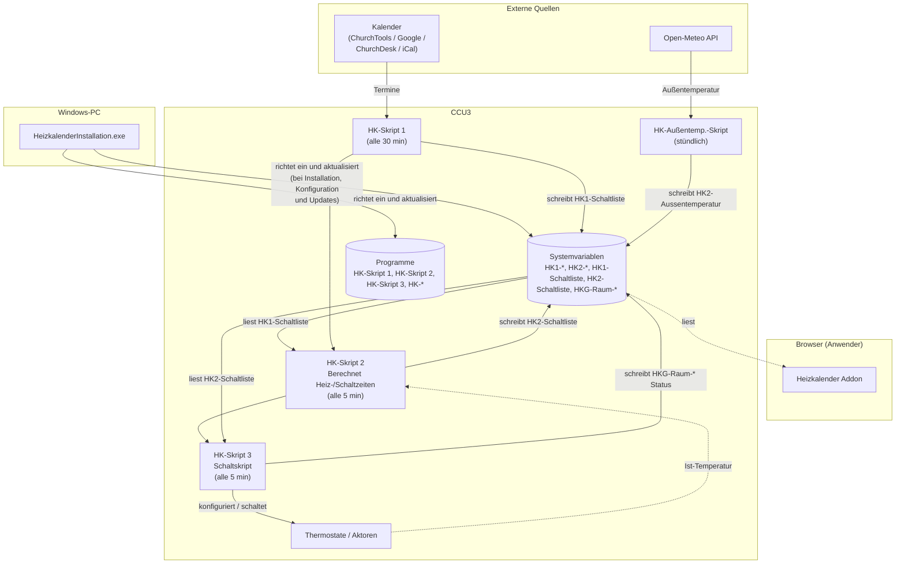
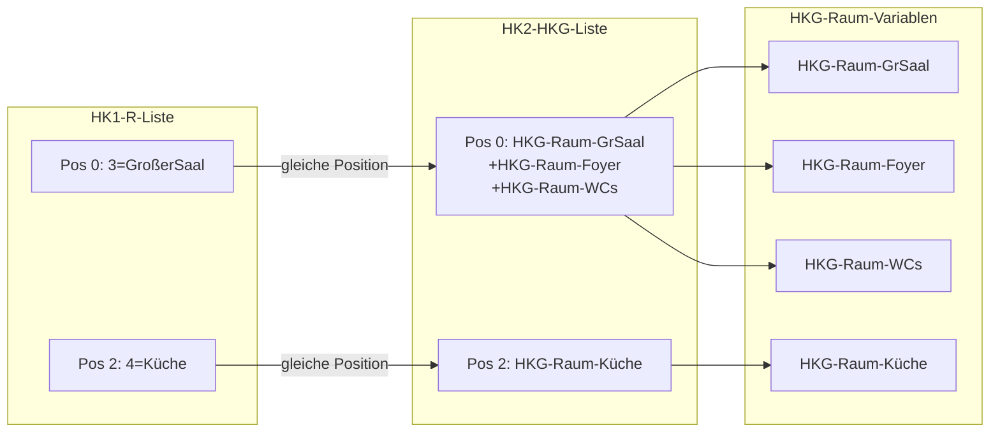

# Entwickler-Dokumentation

Diese Seite richtet sich an Mitwirkende, die am Code des Heizkalenders arbeiten:
an den HomeMatic-Skripten oder am Windows-Installationsprogramm.

## Hilfreiche Tools zur Entwicklung

Die nachfolgenden Tools wurden eingesetzt für die Programmierung des Heizkalenders:

- [NotePad++ als Editor](https://notepad-plus-plus.org/) für Skripte
- [Notepad++ Sprach-Erweiterung - Lexxer Plugin](https://github.com/xMRi/HomematicNPPLexerPlugin) für den Homematic Syntax.
- [Script Developer CCU - SDV 5.0](https://github.com/HMMike/Script-Developer-CCU) für den Test und das Debuggen von Skripten und der Eigenschaften der CCU über die Inspektor Funktion.
    Ich kann die Nutzung dieses Tools jedem Homematic Entwickler nur anraten.
- [Visual Studio 2026](https://visualstudio.microsoft.com/de/vs/community/) für die Entwicklung und Programmierung der `HeizkalenderInstallation.exe`

## Architektur-Überblick

Der Heizkalender besteht aus drei Teilen:

1. **HomeMatic-Skripte** (`.hsc`-Dateien), die direkt auf der CCU laufen.
2. **HeizkalenderInstallation**, eine Windows-MFC-Anwendung (C++/Win32) zum
   Einrichten und Aktualisieren der Skripte und Systemvariablen auf der CCU.
3. **Heizkalender Addon**, eine optionale Web-Oberfläche, die als CCU-Addon
   installiert wird und Statusanzeige, Log-Auswertung und Grundeinstellungen
   direkt im Browser bietet.



Die Skripte kommunizieren ausschließlich über **Systemvariablen** auf der CCU.
Der Laufzeit-Ablauf:

1. Eine **Skript-1-Variante** liest Termine aus einer externen Quelle
   (ChurchTools, ChurchDesk, iCal oder Google) und schreibt sie in die
   Systemvariable `HK1-Schaltliste`.
2. **HK-Skript 2** läuft alle 5 Minuten, liest `HK1-Schaltliste` berechnet die Schaltzeiten und speichert diese in der Systemvariable `HK1-Schaltliste`.
3. **HK-Skript 3** läuft alle 5 Minuten, liest `HK2-Schaltliste` und schaltet die
   Thermostate entsprechend.
4. Das **Addon** liest dieselben Systemvariablen lesend aus und stellt sie im
   Browser dar; es schreibt nichts in die Skript-Variablen zurück.

Es wird immer nur eine Skript-1-Variante eingesetzt. Alle Skripte eines
Release-Standes gehören zusammen und müssen gemeinsam eingespielt werden.

`HK-Skript 1` läuft alle 30 Minuten. `HK-Skript 2` und `HK-Skript 3` laufen beide alle 5 Minuten.  
Dadurch kann es zu gleichzeitigen Laufzeiten kommen. Alle Skripte sind über Verzögerungen so eingestellt dass die Reihenfolge immer `HK-Skript 1` ->`HK-Skript 2` -> `HK-Skript 3` garantiert ist.


## Systemvariablen-Formate

Die vier zentralen Schnittstellenvariablen haben ein festgelegtes Textformat.
Änderungen am Format erfordern immer eine gleichzeitige Anpassung aller
Skripte, die diese Variable lesen oder schreiben, sowie des Addons, das die
Variablen für die Anzeige im Browser parst.

### HK1-R-Liste

Ordnet jeder Kalender-Ressource einen lesbaren Namen zu. Skript 1 schreibt
diese Variable; Skript 2 und der Installer lesen sie.

```txt
ID1[=Name1];ID2[=Name2];...
```

| Feld | Inhalt |
| :--- | :--- |
| ID | Numerische Ressourcen-ID aus dem Kalendersystem |
| Name | Optionaler Klarname, getrennt durch `=` |

Trennzeichen zwischen Einträgen: `;`. Der Name-Teil kann entfallen; dann steht
nur die ID.

Beispiel: `16=Gr. Saal;17=Kl. Saal;18`

### HK2-HKG-Liste

Ordnet jeder Ressource aus `HK1-R-Liste` eine oder mehrere Raum-Systemvariablen zu.
Die Reihenfolge der Einträge entspricht der Reihenfolge in `HK1-R-Liste`.

Über das `+`-Zeichen lassen sich Räume zu einer Gruppe zusammenschalten: wird die
Ressource gebucht, heizt HK-Skript 2 automatisch alle Räume der Gruppe. So kann
z.B. bei einer Buchung des Großen Saals gleichzeitig das Foyer und das Gäste-WC
mitgeheizt werden, ohne dass dafür separate Kalendereinträge nötig sind.

```txt
HKG-Raum-A[+HKG-Raum-B];HKG-Raum-C;...
```

| Trennzeichen | Bedeutung |
| :--- | :--- |
| `;` | Trennt Einträge (je einer pro Ressource) |
| `+` | Verbindet mehrere Raum-Systemvariablen zu einer gemeinsam geschalteten Gruppe |

Beispiel: `HKG-Raum-GrSaal+HKG-Raum-Foyer+HKG-Raum-GaesteWC;HKG-Raum-KlSaal`

**Wichtig:** Die Verknüpfung zwischen `HK1-R-Liste` und `HK2-HKG-Liste` ist rein positionsbasiert.
Skript 1 sucht die ResID in `HK1-R-Liste`, merkt sich den Index und liest an gleicher Position
in `HK2-HKG-Liste` nach. Beide Listen müssen daher immer gleich viele Einträge haben und
in identischer Reihenfolge gepflegt werden.



### HKG-Raum-*

Jeder Raum hat eine eigene Systemvariable `HKG-Raum-<Name>`. Der Wert ist
eine semikolongetrennte Liste mit sechs Pflichtfeldern und einem optionalen
siebten Feld:

```txt
Status;Modus;Heiztyp;Wohlfühltemp[/Grundtemp];Vorheizzeit[*Faktor];VorzeitAus[;Thermostat[;Schaltaktor1[;Schaltaktor2...]]]
```

| Feld | Index | Typ | Werte |
| :--- | :---: | :--- | :--- |
| Status | 0 | Integer | `0` = keine Heizphase, `1` = Heizphase aktiv |
| Modus | 1 | String | `H` = Heizen, `S` = Schalten, `HS` = Heizen + Schalten, `V` = Variable setzen |
| Heiztyp | 2 | String | `IP`, `RT`, `TC`, `IT` (Thermostate), `SW` (Schalt-Aktor) |
| Wohlfühltemp | 3.0 | Float | Zieltemperatur in °C; |
| Grundtemp | 3.1 | Float | Optional `/Grundtemp` für raumindividuelle Grundtemperatur |
| Vorheizzeit | 4.0 | Integer | Individuelle Vorheizzeit in Minuten;|
| FaktorHeizkurve | 4.1 | Integer | Optional `*faktor1HK2Kurve` (Float, 0,20–5,0): raumspezifischer Multiplikator auf die HK2-Kurve|
| MinimaleVorheizzeit | 4.2 | Integer | Optional `*minimaleVorheizzeit` (Default 15min)|
| VorzeitAus | 5 | Integer | Minuten vor Terminende, nach denen abgeschaltet wird |
| Thermostat | 6 | String | Nur bei Modus `HS`: CCU-Kanaladresse des Thermostats, der als Temperatursensor dient |
| Schaltaktor(en) | 7+ | String | Nur bei Modus `HS`: CCU-Kanaladdresse(n) der Schaltaktoren; mehrere Aktoren werden durch weitere `;`-Felder angehängt |

Trennzeichen innerhalb eines Wertes:

| Zeichen | Bedeutung |
| :--- | :--- |
| `;` | Trennt die Felder voneinander; bei Modus `HS` auch die Schaltaktoren (Felder 7+) |
| `/` | Trennt Wohlfühltemperatur, Grundtemperatur und minimale Vorheizzeit (im Feld Wohlfühltemp) |
| `*` | Trennt Vorheizzeit und Faktor (im Feld Vorheizzeit) |

Beispiele:

- `0;H;IP;18;0;30;...`  
    Heizmodus, HmIP-Thermostat, 18 °C, keine abweichende Grundtemperatur, keine individuelle Vorheizzeit, 30 min vor Terminende aus, keine abweichende minimale Vorheizzeit (15min Default)
- `0;H;IP;21/16;60*1.5*45;30;...`  
    wie oben, aber 21 °C Wohlfühltemperatur, 16 °C Grundtemperatur, 60 min Vorheizzeit mit Faktor 1,5, die Vorheizzeit beträgt mindestens 45min
- `0;HS;SW;21;0;30;BidCoS-RF.ABC12345:1;BidCoS-RF.DEF67890:1`  
    Heizen + Schalten, keine abweichende Grundtemperatur, keine individuelle Vorheizzeit, 30 min vor Terminende aus, keine abweichende minimale Vorheizzeit (15min Default)  
    Thermostat an Feld 6, ein Schaltaktor an Feld 7
- `0;V;SW;21;0;0;xyz`  
    Variable *xyz*, auf true setzen

#### Betriebsmodi im Detail

Der Modus (Feld 1) steuert grundlegend, wie der Heizkalender den Raum behandelt.
Jeder Modus hat unterschiedliche Auswirkungen auf Vorheizzeit-Berechnung,
Aktor-Ansteuerung und Sensorik.

##### `H` — Heizen

Steuert einen Thermostat (z.B. HmIP-eTRV) über dessen Solltemperatur.

| Eigenschaft | Verhalten |
| :--- | :--- |
| Aktor-Typ | Thermostat (Feld 7); Ansteuerung über `DPByHssDP` mit Thermostat-Parameter (`SET_POINT_TEMPERATURE`, `SET_TEMPERATURE` etc. je nach Heiztyp) |
| Sensor (Feld 6) | Optional; CCU-Gerätekanal für IST-Temperatur und Luftfeuchte |
| Vorheizzeit | Vollständig wirksam: Offset + Faktor × HK2-Kurve(AT), skaliert mit faktor2HeizBedarf (IST-Temperatur-Korrektur) |
| AT-Schwelle | Heizvorgang wird unterdrückt wenn Außentemperatur ≥ `HK2-A.Temp.Grenze` |
| Einschalten | Setzt Solltemperatur (Wohlfühltemp) am Thermostat |
| Ausschalten | Setzt Grundtemperatur am Thermostat |
| Heizkurvenkontrolle | Aktiv — protokolliert Heizbeginn, Zieltemperatur, Terminbeginn/-ende |

##### `HS` — Heizen + Schalten

Kombiniert einen Thermostat als Temperatursensor (Feld 6) mit einem oder
mehreren Schaltaktoren (Feld 7+). Typisch für Fußbodenheizungen mit
separatem Stellantrieb.

| Eigenschaft | Verhalten |
| :--- | :--- |
| Aktor-Typ | Thermostat an Feld 6 (nur als Sensor), Schaltaktor(en) ab Feld 7; Ansteuerung über `DPByHssDP("STATE")` |
| Sensor (Feld 6) | CCU-Gerätekanal des Thermostats — wird für IST-Temperatur gelesen |
| Vorheizzeit | Wie `H`: Offset + Faktor × HK2-Kurve(AT), skaliert mit faktor2HeizBedarf (IST-Temperatur-Korrektur) |
| AT-Schwelle | Wie `H`: Heizvorgang wird unterdrückt wenn AT ≥ Grenze |
| Einschalten | Setzt Solltemperatur am Thermostat (Feld 6) **und** schaltet Aktoren ein (Feld 7+) |
| Ausschalten | Setzt Grundtemperatur am Thermostat **und** schaltet Aktoren aus |
| Heizkurvenkontrolle | Aktiv |

##### `S` — Schalten

Schaltet einen Aktor (z.B. Relais, Steckdose) ein/aus ohne
Temperatursteuerung.

| Eigenschaft | Verhalten |
| :--- | :--- |
| Aktor-Typ | Schaltaktor (Feld 7); Ansteuerung über `DPByHssDP("STATE")` |
| Sensor (Feld 6) | Nicht verwendet (leer lassen) |
| Vorheizzeit | Nur der feste Offset (Feld 4) wird verwendet; kein faktor1HK2Kurve, kein faktor2HeizBedarf, keine HK2-Kurve |
| AT-Schwelle | **Keine** — Schaltvorgang wird immer ausgeführt, unabhängig von der Außentemperatur |
| Einschalten | `State(1)` auf dem Schaltaktor |
| Ausschalten | `State(0)` auf dem Schaltaktor |
| Heizkurvenkontrolle | Übersprungen |

##### `V` — Variable setzen

Setzt eine CCU-Systemvariable auf `true`/`false` statt einen physischen
Aktor zu schalten. Nützlich für Automatisierungen, die auf
Systemvariablen reagieren (z.B. Lüftung, Beschattung, Benachrichtigungen).

| Eigenschaft | Verhalten |
| :--- | :--- |
| Aktor-Typ | CCU-Systemvariable (Feld 7); **kein** `DPByHssDP` — das Variablen-Objekt wird direkt über `State()` gesetzt |
| Sensor (Feld 6) | Nicht verwendet; darf einen Variablennamen enthalten, wird aber von der Sensorik **nicht** über `DPByHssDP` gelesen |
| Vorheizzeit | Nur der feste Offset (Feld 4); kein faktor1HK2Kurve, kein faktor2HeizBedarf, keine HK2-Kurve |
| AT-Schwelle | **Keine** — Variable wird immer gesetzt, unabhängig von der Außentemperatur |
| Einschalten | `State(1)` auf der Systemvariable |
| Ausschalten | `State(0)` auf der Systemvariable |
| Heizkurvenkontrolle | Übersprungen |

> **Achtung:** Im Modus `V` darf `DPByHssDP` auf den Objekten in Feld 6/7
> nicht aufgerufen werden — Systemvariablen haben keine HSS-Datenpunkte.
> Code, der auf Felder der Raumvariable zugreift, muss den Modus prüfen.

### HK1-Schaltliste

Übergabepuffer von `HK-Skript 1` an `HK-Skript 2`. Wird automatisch befüllt und
ausgelesen; niemals manuell verändern.

Mehrere Einträge stehen direkt hintereinander ohne zusätzliches Trennzeichen;
jeder Eintrag besteht aus fünf semikolongetrennten Feldern:

```txt
RessourcenID;Startzeit;Endezeit;Steuerung;ModusRessourcenID;Startzeit;...
```

| Feld | Typ | Inhalt |
| :--- | :--- | :--- |
| RessourcenID | Integer | Ressourcen-ID (gemäß `HK1-R-Liste`) |
| Startzeit | Datum | Terminbeginn im Format yyyy-mm-dd hh:mm:ss |
| Endezeit | Datum | Terminende im Terminbeginn im Format yyyy-mm-dd hh:mm:ss |
| Spezielle Steuerbefehle | Integer | Steuerungswert aus dem Termintext: `0` = normal, `-1` = `#EIN#`, `-2` = `#AUS#`, `-3` = `#RESET#`, positive Zahl = Temperatur aus `#<Zahl>#` |
| Modus | String | `H` = Heizen, `S` = Schalten, `HS` = Heizen+Schalten, `V` = Variable setzen |

Trennzeichen:

| Zeichen | Bedeutung |
| :--- | :--- |
| `;` | Trennt die Felder innerhalb eines Eintrags |
| (keines) | Einträge folgen direkt aufeinander; der Modus-Wert des vorherigen Eintrags grenzt unmittelbar an die RessourcenID des nächsten |

Beispiele:

- Ein Eintrag: `4;2026-10-14 18:30:00;2026-10-14 20:30:00;0;H` (Ressource 4, 14.10.2026 18:30 Uhr bis 20:30 Uhr, Heizmodus)
- Zwei Einträge hintereinander: `4;2026-10-14 18:30:00;2026-10-14 20:30:00;0;H;2;2026-10-14 18:30:00;2026-10-14 20:30:00;0;S;` (Ressource 4 Heizen, Ressource 2 Schalten, gleicher Startzeitpunkt)

### HK1-Vorlaufzeit

Optionale Systemvariable (Typ Integer, Einheit: min). Legt fest, wie weit Skript 1
beim Einlesen des Kalenders in die Zukunft schaut (Zeithorizont für die
Terminabfrage). Wird die Variable nicht angelegt, verwendet Skript 1 den
hardcodierten Default von 720 min (12 Stunden).

| Feld | Wert |
| :--- | :--- |
| Typ | Integer |
| Einheit | min |
| Default (ohne Variable) | 720 |
| Wertebereich | 0 bis 1380 (23 Stunden) |

Alle fünf Skript-1-Varianten lesen die Variable beim Start; ist sie nicht vorhanden,
bleibt der Default aktiv. Setzt der Administrator die Variable auf einen kleineren
Wert (z.B. 120 min), schaut Skript 1 nur 2 Stunden voraus und trägt Termine nicht
mehr frühzeitig in die Schaltliste ein.

### HK2-Kurve

Acht semikolongetrennte Ganzzahlen (Vorheizzeiten in Minuten) für die festen
Außentemperatur-Stützpunkte −10, −5, 0, 8, 10, 12, 15, 17,5 °C.

```txt
V1;V2;V3;V4;V5;V6;V7;V8
```

Zwischen den Stützpunkten interpoliert HK-Skript 2 linear. Der erste Wert
(tiefste Außentemperatur) ist die längste Vorheizzeit. Installer-Default:
`162;130;100;59;50;41;30;20`.

Beispielkurven und Berechnungshintergrund:
[Anwenderhandbuch](anwenderhandbuch.md#die-heizkurve-hk2-kurve),
[Heizsteuerung-Vorheizzeit.md](heizsteuerung-vorheizzeit.md)

### HK2-Kurvenanpassung

Optional. Faktor K für das Zwei-Geraden-Modell der `faktor2HeizBedarf`-Berechnung (0,3 bis 1,0).

Steuert, wie stark die Vorlaufzeit bei bereits vorgeheizten Räumen reduziert wird:
bei 1,0 ergibt sich eine lineare Gerade (maximale Reduzierung), bei 0,8 die Standardkurve mit
mehr Reserve in der Mitte, bei 0,6 wird die Reduzierung abgemildert (längere Vorlaufzeiten
bei IST-Temperaturen über 15 °C).

Fehlt die Variable auf der CCU, verwendet `HK-Skript 2` automatisch den Wert 0,8.
Werte außerhalb des Bereichs 0,3..1,0 werden auf diesen Bereich begrenzt.

Empfehlung: 0,6 für Gebäude mit Brennwertkessel, schwerer Bausubstanz und schwachen Heizkörpern.

### HK2-Schaltliste

Übergabepuffer von `HK-Skript 2` an `HK-Skript 3`. Wird automatisch befüllt und
ausgelesen; niemals manuell verändern.

Einzelne Einträge werden durch # (Raute) getrennt, einzelne Felder durch ; (Semikolon).

```txt
Raumvariable;Terminstartzeit;Terminende;Sonderbefehl;Heiz-/Schaltstart;Heiz-/Schaltende;Außentemperatur;Isttemperatur#...
```

| Feld | Index | Typ | Bedeutung |
| ---- | ----- | --- | --------- |
| Raumvariable | 0 | String | HKG-Raum Variable für diesen Termin |
| Terminstartzeit | 1 | Zeitstempel | Original Startzeit des Termins aus `HK1-Schaltliste` |
| Terminende | 2 | Zeitstempel | Original Endzeit des Termins aus `HK1-Schaltliste` |
| Sonderbefehl | 3 | String | Sonderbefehl aus `HK1-Schaltliste` (Dauer-Ein/Dauer-Aus/Raumtemperatur abweichend definiert) |
| Heiz-/Schaltstart | 4 | Zeitstempel | In `HK-Skript 2` berechnete Startzeit für Heizen/Schalten unter Berücksichtigung der Vorheizzeit und Raumparameter |
| Heiz-/Schaltende | 5 | Zeitstempel | In `HK-Skript 2` berechnete Startzeit für Heizen/Schalten unter Berücksichtigung der Raumparameter |
| Außentemperatur | 6 |  String | Außentemperatur bei der letzten Aktualisierung  |
| Isttemperatur | 7 |  String | Isttemperatur bei der letzten Aktualisierung (damit Temperatur bei Heizstart) |

Beispiel:

```txt
HKG-Raum-Küche;2026-11-04 10:00:00;2026-11-04 12:00:00;0;2026-11-04 09:02:00;2026-11-04 11:30:00;8.1;18.4#HKG-Raum-Küche;2026-11-04 18:00:00;2026-11-04 20:30:00;0;2026-11-04 17:02:00;2026-11-04 20:00:00;8.1;18.4#HKG-Raum-Foyer;2026-11-04 18:30:00;2026-11-04 20:30:00;0;2026-11-04 17:32:00;2026-11-04 20:00:00;8.1;16.0#HKG-Raum-KlSaal;2026-11-04 18:30:00;2026-11-04 20:30:00;0;2026-11-04 17:32:00;2026-11-04 20:00:00;8.1;20.0#HKG-Raum-WCs;2026-11-04 18:30:00;2026-11-04 20:30:00;0;2026-11-04 17:32:00;2026-11-04 20:00:00;8.1;16.0#
```


### HK2-Schaltzeiten

Wird von `HK-Skript 2` am Ende jedes Skriptlaufs geschrieben (sofern die Variable auf der CCU vorhanden ist). Enthält die berechneten Schaltzeiten aller Ressourcen des letzten Skriptlaufs. Die Variable ist rein informativ und wird vom Benutzer nicht manuell gesetzt.

Einträge sind durch `~` getrennt, Felder innerhalb eines Eintrags durch `;`:

```txt
RaumVarName;VorlaufMin;HeizenAb;TerminAb;TerminBis;VorlaufzeitAusMin~...
```

| Feld | Typ | Bedeutung |
| ---- | --- | --------- |
| RaumVarName | String | Name der HKG-Raum-Systemvariable (z.B. `HKG-Raum-GrSaal`) |
| VorlaufMin | Integer | Berechnete Vorheizzeit in Minuten (0 bei Schaltmodus) |
| HeizenAb | Zeitstempel | Berechneter Einschaltzeitpunkt (`YYYY-MM-DD HH:MM:SS`) |
| TerminAb | Zeitstempel | Terminbeginn (ohne Vorlaufverschiebung) |
| TerminBis | Zeitstempel | Terminende |
| VorlaufzeitAusMin | Integer | Vorlaufzeit Aus in Minuten (vorzeitiges Heizende; 0 wenn nicht konfiguriert) |

Bei Multi-Raum-Zuordnungen (mehrere Räume je Ressource) enthält die Variable einen eigenen Eintrag pro Raum mit der jeweils individuell berechneten Vorheizzeit.

> **Hinweis (Stand 25.10.2026):** Das erste Feld wurde von der RessourcenID auf den Raumvariablennamen (`HKG-Raum-*`) umgestellt. Wer zwischen dem 23.10. und 25.10.2026 installiert hat, muss Skript 2 und das Addon gemeinsam aktualisieren, da das Addon den neuen Schlüssel erwartet.

Beispiel (drei Räume, davon zwei an derselben Ressource):

```txt
HKG-Raum-GrSaal;320;2026-10-18 04:10:00;2026-10-18 09:30:00;2026-10-18 12:00:00;0~HKG-Raum-Foyer;95;2026-10-18 07:55:00;2026-10-18 09:30:00;2026-10-18 12:00:00;0~HKG-Raum-WC;45;2026-10-18 08:45:00;2026-10-18 09:30:00;2026-10-18 12:00:00;0~
```

### HK-RäumeHeizkurvenkontrolle

Speichert den laufenden Zustand der Heizkurvenkontrolle für alle überwachten Räume. Wird von `HK-Heizkurvenkontrolle.hsc` geschrieben und bei jedem Skriptlauf aktualisiert. Die Variable ist flüchtig (kein USB-Backup).

```txt
#<Raumvariable>;<Status>;<IstTemp>#<Raumvariable>;<Status>;<IstTemp>#...
```

| Feld | Typ | Bedeutung |
| ---- | --- | --------- |
| Raumvariable | String | Name der `HKG-Raum-*`-Systemvariable |
| Status | Integer (Bitmap) | Zustand des Raums in der aktuellen Heizphase |
| IstTemp | Float | Zuletzt gemessene Ist-Temperatur des Temperatursensors |

**Status-Bitmap:**

| Bit | Wert | Bedeutung |
| --- | ---- | --------- |
| 0 | 1 | Heizung an |
| 1 | 2 | Zieltemperatur erreicht |
| 2 | 4 | Heizung ausgeschaltet |
| 3 | 8 | Hinweis „kein Temperatursensor" bereits geloggt (wird nur einmal pro Heizphase eingetragen) |

Beispiel: `#HKG-Raum-EG-Saal;1;18.1#HKG-Raum-UG-Buero;3;20.3#`

## Skript-Syntax (HomeMatic HSC)

- Kommentarzeichen ist `!`. Für die Editor-Syntaxhervorhebung wird zusätzlich ein
  C-Kommentar gesetzt, daher die kombinierte Form `!//`.
- Stringverkettung erfolgt mit `#` statt `+`.
- `break` und `continue` werden unterstützt (CCU3/RaspberryMatic, nicht CCU2).
- Sonderbefehle in Termintexten: `#EIN#`, `#AUS#`, `#RESET#`, `#GT#`, `#NS#`,
  `#NH#`, `#<Zahl><Text>#` (siehe
  [Anwenderhandbuch](anwenderhandbuch.md#sonderbefehle-in-terminen)).

Die Dateiendung `.hsc` ist eine bewusste Wahl (siehe
[Skript-Referenz](../skripte/readme.md)); historisch wurde `.c` verwendet.

## Build der `HeizkalenderInstallation.exe` (Windows, Visual Studio)

Das Installations-Projekt liegt in `HeizkalenderInstallation/`:

- Projektdatei: `HeizkalenderInstallation.vcxproj`
- Solution: `HeizkalenderInstallation.slnx`
- Zielplattform: Windows 10+, Win32/x64, MFC Unicode
- Konfigurationen: Debug/Release × Win32/x64

Es gibt keine Makefiles oder Build-Skripte für macOS/Linux; die `HeizkalenderInstallation.exe` ist
rein Windows-seitig.

Wichtige Klassen:

- `CPropertySheet` + `CPageBase`-Ableitungen: mehrseitiger Wizard (Connect, Räume,
  Ressourcen, Systemvariablen)
- `CScriptEngine`: führt HomeMatic-Skripte auf der CCU aus (HTTP POST)
- `CWGetEngine`: HTTP-Client (WinINet)
- `CData` / `TDataList<>`: Modell für Systemvariablen und Skripteinträge

## Versionierung

Es gibt keine Versionsnummern in den Dateinamen. Der Stand jedes Skriptes steht
als Datum im Datei-Header (`!// Stand:`). Kompatible Skripte finden sich immer in
einem GitHub-Release mit demselben Datums-Tag (`vJJJJ-MM-TT`).

Die Änderungshistorie über alle Stände hinweg steht im zentralen
[CHANGELOG.md](https://github.com/xMRi/Homematic-Heizungskalender/blob/main/CHANGELOG.md).

## Änderungs-Workflow

Wird eine `.hsc`-Datei (oder `HeizkalenderInstallation.exe`-Quelle) inhaltlich geändert, gehören dazu
immer die folgenden Schritte:

1. **Stand aktualisieren:** Datum in der `!// Stand:`-Zeile im Datei-Header auf das
   aktuelle Datum setzen.
2. **Changelog im Header fortschreiben:** Neuen `!// MRi: JJJJ-MM-TT`-Eintrag ganz
   oben in den Changelog-Block des Headers einfügen (neueste Einträge oben). Kurz
   beschreiben, *was* und *warum* geändert wurde.
3. **Zentrales [CHANGELOG.md](https://github.com/xMRi/Homematic-Heizungskalender/blob/main/CHANGELOG.md) fortschreiben:** Eintrag unter dem
   passenden Datums-Stand ergänzen (Keep-a-Changelog-Format, Kategorien
   Hinzugefügt/Geändert/Behoben/Entfernt).
4. **Dokumentation prüfen:** Neue oder umbenannte Systemvariablen müssen in der
   [Skript-Referenz](../skripte/readme.md) erscheinen.
5. **`HeizkalenderInstallation.exe` anpassen (nur bei neuen/geänderten Systemvariablen):** Die
   `HeizkalenderInstallation.exe`
   liest die Systemvariablen NICHT aus den `.hsc`-Dateien, sondern legt sie über
   eigene, fest einkompilierte Meta-Skripte an
   (`HeizkalenderInstallation/res/SYSVARS_Init_*.hsc` sowie `SYSVARS-Init.hsc` /
   `SYSVARS-InitValues.txt`). Wird eine neue Systemvariable eingeführt, umbenannt
   oder ihr Default geändert, muss sie dort von Hand ergänzt werden, sonst legt
   die `HeizkalenderInstallation.exe` sie nicht an.

**Konsistenz-Hinweis Systemvariablen:** Werden Variablen in den
`HK-Init-Skript 1_*.hsc` über die parallelen Arrays (`nm`/`be`/`tp`/`vl`/`vu`/`wr`/`pr`)
angelegt, muss jeder neue Eintrag in ALLEN Arrays an gleicher Index-Position
stehen. Beschreibungstexte (`be`) dürfen KEIN Semikolon enthalten, da es als
Array-Trenner interpretiert wird.

## Messdaten-Auswertung

Zur Analyse von Temperaturverläufen und Optimierung der Heizkurve können die
RRD4J-Diagrammdaten der CCU exportiert werden. Die Anleitung dazu ist in einem
eigenen Dokument beschrieben: [Messdaten-Auswertung](messdaten-auswertung.md)

## Heizkalender Addon

Das Heizkalender Addon ist eine eigenständige Komponente mit eigener Entwicklerdokumentation.
Sie beschreibt Verzeichnisstruktur, Paketformat, rc.d-Script, CGI-Seiten und die
Besonderheiten von Tcl 8.2 auf der CCU3.

Vollständige Dokumentation: [../addon/entwickler.md](../addon/entwickler.md)
