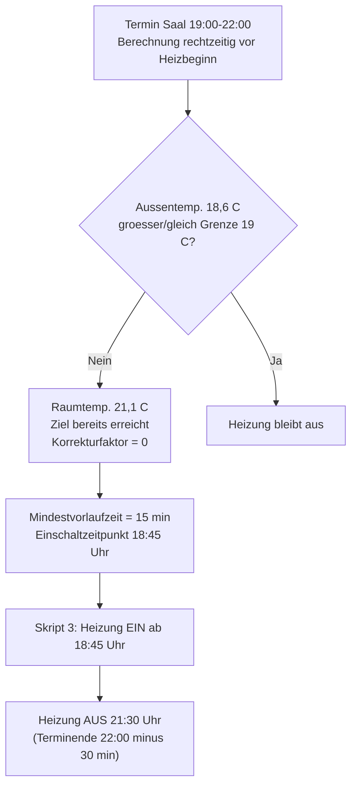
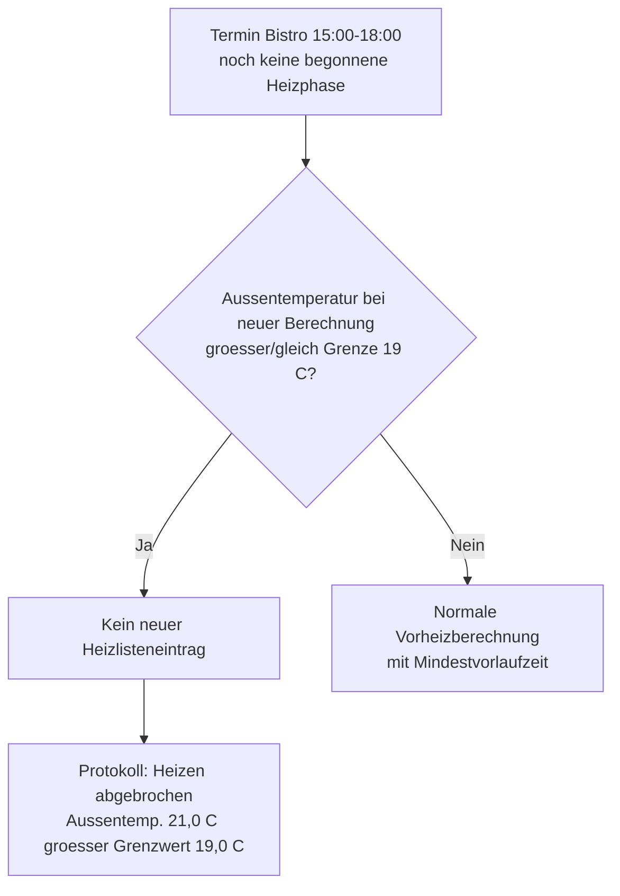
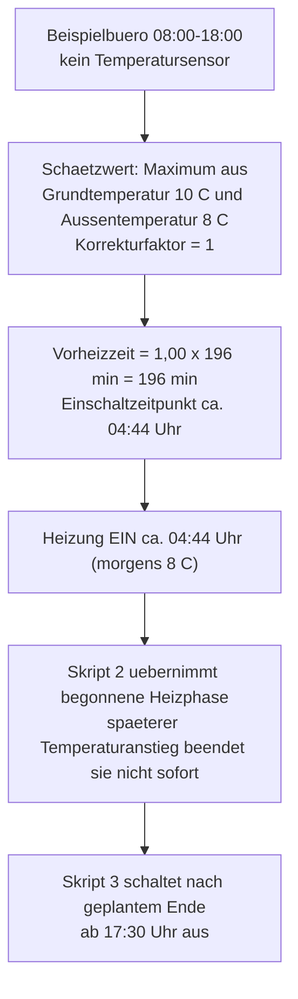

# Heizsteuerung: Vorheizzeit-Logik

Dieses Dokument erklärt, wie das Hauptskript `HK-Skript 2` den Einschaltzeitpunkt der Heizung
berechnet. Es geht dabei nicht um eine Vorlauftemperatur, sondern um eine **ereignisgesteuerte
Zeitsteuerung**: Das Skript berechnet, wie viele Minuten vor einem Termin die Heizung eingeschaltet
werden muss, damit der Raum pünktlich die gewünschte Temperatur erreicht.

## Verarbeitungskette

```txt
Kalender-Skript 1 --> HK1-Schaltliste --> Skript 2: Schaltzeiten berechnen
                                             ^                 |
Außentemperatur-Skript --> HK2-Aussentemperatur |                 v
                                                       HK2-Schaltliste
                                                               |
                                                               v
                                                   Skript 3: Aktoren steuern
```

Skript 2 und Skript 3 laufen jeweils alle **5 Minuten**. Skript 2 berechnet die Zeiten neu, übernimmt jedoch bereits begonnene normale Heizphasen gesondert. Bei neuen Berechnungen für H und HS berücksichtigt es die Außentemperaturgrenze. Skript 3 prüft anschließend die berechneten Ein- und Ausschaltzeiten sowie den Raumstatus und steuert die Aktoren. Berechnung und tatsächliches Schalten sind getrennte Schritte.

## Systemvariablen (Konfiguration)

| Variable | Bedeutung | Beispielwert |
| :--- | :--- | :--- |
| `HK2-Grundtemperatur` | Absenktemperatur wenn nicht geheizt wird | 10,0 °C |
| `HK2-A.Temp.Grenze` | Unterdrückt neue Heizberechnungen bei Außentemperatur ab der Grenze; kein zugesagter sofortiger Abbruch bereits übernommener Heizphasen | 19,0 °C |
| `HK2-Aussentemperatur` | Aktuelle Außentemperatur (von Außentemperatur-Skript) | 8,0 °C |
| `HK2-Kurve` | Vorheizzeit-Kurve: 8 Werte für 8 Außentemperatur-Stützpunkte | siehe unten |
| `HK2-VorzeitAus` | Globaler Grund-Offset zum vorzeitigen Ausschalten (Minuten); gilt nur für echte Heizvorgänge, nicht für reine Schaltrelais | 0 min |

## Die Vorheizzeit-Kurve

Die Kurve besteht aus **8 Stützpunkten**, die die volle Vorheizzeit (bei unbeheiztem Raum)
für verschiedene Außentemperaturen angeben. Zwischen den Stützpunkten wird **linear interpoliert**.
Für Außentemperaturen über 17,5 °C extrapoliert das Skript über den letzten Abschnitt hinaus
(begrenzt auf mindestens 0 Minuten).

| # | Außentemperatur | Volle Vorheizzeit | (in h:min) |
| :---: | ---: | ---: | ---: |
| 1 | −10 °C | 451 min | 7 h 31 min |
| 2 | −5 °C | 370 min | 6 h 10 min |
| 3 | 0 °C | 297 min | 4 h 57 min |
| 4 | 8 °C | 196 min | 3 h 16 min |
| 5 | 10 °C | 174 min | 2 h 54 min |
| 6 | 12 °C | 154 min | 2 h 34 min |
| 7 | 15 °C | 125 min | 2 h 05 min |
| 8 | 17,5 °C | 103 min | 1 h 43 min |

_Diese Werte entsprechen der großzügigen Beispielkonfiguration (`451;370;297;196;174;154;125;103`). Bei der Installation werden sie individuell gesetzt._

### Bezugstemperaturen der HK2-Kurve

Die HK2-Kurve beschreibt, wie lange ein für das Gebäude typischer Raum bei einer bestimmten Außentemperatur braucht, um von einer unteren Bezugstemperatur (Grundtemperatur, GT) auf eine obere Bezugstemperatur (Wohlfühltemperatur, WT) aufzuheizen. Beide Bezugstemperaturen werden bei der Festlegung der Kurve individuell für die Installation gewählt.

Die Standardannahme für die Auslegung beträgt 15 °C Grundtemperatur und 20 °C Wohlfühltemperatur. Das entspricht 5 K. Für eine Ferienwohnung kann beispielsweise eine obere Bezugstemperatur von 21 °C angesetzt werden.

| Anwendungsbereich | GT | WT | Temperaturdifferenz |
| :--- | ---: | ---: | ---: |
| Standardannahme | 15 °C | 20 °C | 5 K |
| Gemeindegebäude mit starker Absenkung | 10 °C | 20 °C | 10 K |
| Ferienwohnung | 15 °C | 21 °C | 6 K |
| Gebäude mit geringer Absenkung | 17 °C | 21 °C | 4 K |

Die Stützpunkte der HK2-Kurve richten sich nach dem tatsächlichen Aufheizverhalten für den gewählten Temperaturbereich. Die über `HK2-Grundtemperatur` konfigurierte globale Grundtemperatur entspricht in der Regel der unteren Bezugstemperatur. Die obere Bezugstemperatur der Kurve hat kein eigenes Eingabefeld im Heizkalender. Die Wohlfühltemperatur wird je Raum festgelegt. Dokumentieren Sie deshalb beide Bezugstemperaturen zusammen mit den Kurvenwerten.

## Die Berechnungsformel

Die tatsächliche Vorheizzeit (VLZ) setzt sich aus zwei Teilen zusammen: einem
raumspezifischen Basisoffset und dem temperaturabhängigen Kurvenwert. Beide werden gemeinsam
mit einem Dämpfungsfaktor skaliert, der den verbleibenden Heizbedarf widerspiegelt:

$$
\text{VLZ}_{\text{roh}} = f_2(T_{\text{ist}}) \cdot \bigl(V + V_{\text{global}} + f_1 \cdot \text{HK2}(T_{\text{at}})\bigr)
$$

$$
\text{VLZ}_{\text{eff}} = \max\bigl(\text{VLZ}_{\text{roh}}, T_{\text{Mindest}}\bigr)
$$

Diese Formeln beschreiben das Modell für normale Heizvorgänge in H und HS. Im Skript werden die beiden Zeitanteile getrennt in Ganzzahlen umgewandelt, bevor die Mindestvorlaufzeit angewendet wird; bei Nachkommastellen kann die genaue Ausgabe daher von einer erst am Ende gerundeten Modellrechnung abweichen.

| Symbol | Variablenname | Beschreibung |
| :--- | :--- | :--- |
| VLZ | | Berechnete Vorheizzeit in Minuten |
| $f_2$ | `faktor2HeizBedarf` | Temperaturabhängiger Heizbedarf-Faktor; bei IST unter Grundtemperatur auch größer als 1 |
| $V$ | | Raumspezifische Basisheizzeit in Minuten (aus Raumvariable) |
| $V_{\text{global}}$ | `HK2-Kurvenversatz` | Zusätzlicher globaler Einschaltversatz in Minuten |
| $T_{\text{Mindest}}$ | Raumvariable, optionaler dritter `*`-Wert | Mindestvorlaufzeit, standardmäßig 15 Minuten, begrenzt auf 1 bis 480 Minuten |
| $f_1$ | `faktor1HK2Kurve` | Raumspezifischer Multiplikator auf die HK2-Kurve |
| $T_{\text{ist}}$ | | Aktuelle Raumtemperatur (°C) |
| $T_{\text{at}}$ | | Außentemperatur (°C), aus `HK2-Aussentemperatur` (gleitender Mittelwert) |
| HK2 | | Heizzeit als Funktion der Außentemperatur (linear interpoliert) |

### faktor2HeizBedarf (Zwei-Geraden-Modell)

Bei unterschiedlicher Grund- und Zieltemperatur berechnet `faktor2HeizBedarf` den verbleibenden Heizbedarf. Bei IST gleich Grundtemperatur ist er 1; bei erreichter Zieltemperatur ist er 0. Unterhalb der Grundtemperatur steigt der Faktor über 1 und verlängert die Vorheizzeit. Die Mindestvorlaufzeit wird danach separat angewendet.

$$
f_2(T_{\text{ist}}) = \begin{cases} 1 - K \cdot \dfrac{T_c - T_G}{T_W - T_G} & \text{wenn } T_{\text{ist}} < M \\[12pt] (2 - K) \cdot \left(1 - \dfrac{T_c - T_G}{T_W - T_G}\right) & \text{wenn } T_{\text{ist}} \geq M \end{cases}
$$

Für den normalen Fall $T_W > T_G$ gelten $T_c = \min(T_{\text{ist}}, T_W)$ und der Mittelpunkt $M = T_G + \dfrac{T_W - T_G}{2}$. Bei gleicher Grund- und Zieltemperatur wird dieser Formelzweig nicht ausgeführt; der initialisierte Faktor bleibt 1.

| Symbol | Bedeutung | Beispiel |
| :--- | :--- | :--- |
| $T_G$ | Grundtemperatur (`HK2-Grundtemperatur`) | 10 °C |
| $T_W$ | Wohlfühltemperatur (Zieltemperatur laut Schaltliste) | 20 °C |
| $K$ | Kurvenanpassung (steuert die Krümmung des Zwei-Geraden-Modells); konfigurierbar über `HK2-Kurvenanpassung` | 0,8 |
| $M$ | Mittelpunkt (Knickstelle der zwei Geraden) | 15 °C |

### faktor1HK2Kurve (raumspezifischer Multiplikator)

`faktor1HK2Kurve` wird aus Feld 4 der Raumvariable gelesen (Suffix `*Faktor`, z. B. `180*1.4`).
Er verschiebt den Kurvenwert nach oben oder unten, ohne den Basisoffset $V$ zu beeinflussen.
Default ist 1,0 (kein Einfluss), erlaubter Bereich 0,20 bis 5,0.

Über den Raumfaktor lassen sich außerdem bauliche und heizungstechnische Eigenschaften sowie Abweichungen der Raumtemperaturvorgaben von den Bezugstemperaturen der HK2-Kurve berücksichtigen. Die [Anpassung der Vorheizzeit an individuelle Räume](#anpassung-der-vorheizzeit-an-individuelle-raume) zeigt, wie Sie einen geeigneten Ausgangswert bestimmen.

### HK2-Kurve (lineare Interpolation)

$$
\text{HK2}(T_{\text{at}}) = v_i + (v_{i+1} - v_i) \;\cdot\; \frac{T_{\text{at}} - a_i}{a_{i+1} - a_i}
$$

wobei $(a_i, v_i)$ und $(a_{i+1}, v_{i+1})$ die zwei benachbarten Stützpunkte sind
mit $a_i \leq T_{\text{at}} \leq a_{i+1}$. Für Außentemperaturen über dem letzten Stützpunkt
extrapoliert das Skript über den letzten Abschnitt hinaus (Minimum: 0 Minuten).

## Die zwei Anteile der Einschaltverschiebung

Der tatsächliche Einschaltzeitpunkt verschiebt sich durch **zwei** getrennt
berechnete Offsets, die beide vom Terminbeginn abgezogen werden:

| Anteil | Herkunft | Verhalten |
| :--- | :--- | :--- |
| **Fester/raum-individueller Offset** | Feld „Vorheizzeit" der Raumvariablen (optional mit `*Faktor`) plus globaler `HK2-Kurvenversatz` | Unabhängig von der Außentemperatur, wird aber ebenfalls mit dem Raumtemperatur-Korrekturfaktor skaliert |
| **Temperaturabhängiger Offset** | Kurvenwert aus `HK2-Kurve` (siehe oben), skaliert mit dem Raumtemperatur-Korrekturfaktor | Hängt von Außen- und Raumtemperatur ab |

Beide Anteile werden addiert. **Wichtig:** Der Raumtemperatur-Korrekturfaktor (siehe oben) wirkt auf
beide Anteile gleichzeitig. Der raum-individuelle Offset ist also zwar unabhängig von der
Außentemperatur, wird aber bei einem bereits warmen Raum genauso reduziert wie der Kurvenanteil.
Wer die Vorheizzeit eines Raumes gezielt verlängern möchte, muss diesen Effekt einplanen:

```txt
Benötigter Offset-Wert = gewünschte Mindest-Vorheizzeit / Korrekturfaktor
Beispiel: 120 min gewünscht, Korrekturfaktor 0,65 → Offset eintragen: 120 / 0,65 ≈ 185 min
```

Der globale `HK2-Kurvenversatz` wirkt dabei als Gegenstück zu `HK2-VorzeitAus` (Ausschalt-Offset)
und wird **nur bei echten Heizvorgängen** berücksichtigt, nicht bei reinem Schalten (Modus `S`).

## Anpassung der Vorheizzeit an individuelle Räume

Raumgröße, Dämmung, Heizleistung und die Trägheit des Heizsystems beeinflussen die benötigte Vorheizzeit. Auch die für den Raum geltende Grund- und Wohlfühltemperatur spielt eine Rolle. Für die Anpassung stehen der Raumfaktor und die feste raumspezifische Vorheizzeit zur Verfügung.

### Abweichende Grund- und Wohlfühltemperaturen

Für eine HK2-Kurve mit 15 °C Grundtemperatur und 20 °C Wohlfühltemperatur beträgt die Temperaturdifferenz 5 K. Bei gleicher Grundtemperatur braucht ein Flur oder WC mit 18 °C Zieltemperatur eine Aufheizung um 3 K, ein Kinderraum mit 22 °C Zieltemperatur eine Aufheizung um 7 K.

Bei gleicher Außentemperatur liefert die HK2-Kurve für beide Räume denselben Ausgangswert. Wenn die aktuelle Raumtemperatur jeweils der geltenden Grundtemperatur entspricht, beträgt `faktor2HeizBedarf` in beiden Fällen 1,0. Dieser Faktor beschreibt den verbleibenden relativen Heizbedarf. Den Unterschied zwischen 3 K und 7 K können Sie bei der Einstellung des Raumfaktors berücksichtigen.

### Berechnung des Raumfaktors

Als erste Näherung kann der Kurvenanteil proportional zur Temperaturdifferenz angepasst werden. Bei einer Referenzdifferenz von 5 K ändert jedes zusätzliche oder entfallende Kelvin den Kurvenanteil um rund 20 % des Referenzwerts.

| GT des Raums | WT des Raums | Temperaturdifferenz | Änderung des Kurvenanteils | Raumfaktor bei Basiswert 1,0 |
| ---: | ---: | ---: | ---: | ---: |
| 15 °C | 18 °C | 3 K | −40 % | 0,6 |
| 15 °C | 19 °C | 4 K | −20 % | 0,8 |
| 15 °C | 20 °C | 5 K | 0 % | 1,0 |
| 15 °C | 21 °C | 6 K | +20 % | 1,2 |
| 15 °C | 22 °C | 7 K | +40 % | 1,4 |
| 12 °C | 20 °C | 8 K | +60 % | 1,6 |
| 17 °C | 20 °C | 3 K | −40 % | 0,6 |
| 10 °C | 20 °C | 10 K | +100 % | 2,0 |

Für die Ersteinrichtung teilen Sie die Temperaturdifferenz des Raums durch die Bezugstemperaturdifferenz der HK2-Kurve.

`Korrekturfaktor = (WT_Raum − GT_Raum) / (WT_Kurve − GT_Kurve)`

`GT_Raum` und `WT_Raum` sind die für den Raum geltende Grund- und Wohlfühltemperatur. `GT_Kurve` und `WT_Kurve` sind die untere und obere Bezugstemperatur der HK2-Kurve. Falls für die Bezugstemperaturen bereits ein Basiswert aufgrund der baulichen oder heizungstechnischen Eigenschaften vorliegt, multiplizieren Sie ihn mit dem Korrekturfaktor.

`Raumfaktor_neu = Raumfaktor_Basis × Korrekturfaktor`

Ein Basiswert von 1,5 ergibt bei einer Aufheizung um 7 K und einer Referenzdifferenz von 5 K den Ausgangswert `1,5 × (7 / 5) = 2,1`.

Wenn Sie bei einem bereits abgestimmten Raum nachträglich die Grund- oder Wohlfühltemperatur ändern, verwenden Sie die bisherige Temperaturdifferenz als Bezug.

`Raumfaktor_neu = Raumfaktor_alt × (WT_neu − GT_neu) / (WT_alt − GT_alt)`

Wird beispielsweise die Wohlfühltemperatur bei 15 °C Grundtemperatur von 20 °C auf 22 °C angehoben, ergibt ein bisheriger Raumfaktor von 1,5 den neuen Ausgangswert 2,1. Rechnen Sie jeweils mit Temperaturpaaren, bei denen die Wohlfühltemperatur über der Grundtemperatur liegt. Wenden Sie eine Korrektur für dieselbe Temperaturabweichung nur einmal an.

Der zulässige Wertebereich für `faktor1HK2Kurve` beträgt **0,20 bis 5,0**. Liegt ein Rechenwert außerhalb dieses Bereichs, verwenden Sie als Ausgangswert die entsprechende Grenze und prüfen Sie den Aufheizverlauf. Die proportionale Rechnung liefert einen Ausgangswert für die Konfiguration. Wärmeverluste und Heizleistung können dazu führen, dass der geeignete Faktor von der Rechnung abweicht.

### Zusammenspiel mit der festen Vorheizzeit

Der Raumfaktor multipliziert ausschließlich den Kurvenwert. Die feste raumspezifische Vorheizzeit und der globale Kurvenversatz `HK2-Kurvenversatz` werden separat eingestellt. Der Heizbedarfsfaktor `faktor2HeizBedarf` skaliert bei der Berechnung sowohl deren Summe als auch den Kurvenanteil anhand der aktuellen Raumtemperatur.

Wenn ein Teil der festen Vorheizzeit ursprünglich für eine bestimmte Temperaturdifferenz angesetzt wurde, können Sie diesen Teil bei geänderten Sollwerten näherungsweise proportional anpassen. Verzögerungen bei der Wärmebereitstellung oder durch die Trägheit des Heizsystems beurteilen Sie gesondert. Prüfen Sie beide Raumparameter anhand der gemessenen Aufheizzeiten, etwa mit der Heizkurvenkontrolle im Addon.

## Sonderfälle

### Außentemperatur-Grenze bei neuen Berechnungen

Ist die Außentemperatur größer oder gleich `HK2-A.Temp.Grenze`, erzeugt Skript 2 bei einer neuen normalen Heizberechnung keinen entsprechenden Heizlisteneintrag. Die verwendete Außentemperatur ist der gleitende Durchschnitt, kein unmittelbarer Momentanwert.

Bereits begonnene normale Heizphasen werden vorher aus der alten Schaltliste übernommen und durchlaufen diese spätere Grenzprüfung nicht erneut. Ein Temperaturanstieg während einer übernommenen Heizphase führt daher nicht automatisch zum sofortigen Ausschalten. Skript 3 beendet sie nach den weiter gültigen Schaltzeiten und seiner Auffanglogik.

Systemprotokoll-Eintrag: _„Heizen abgebrochen Aussentemperatur 21,0 °C größer Grenzwert 19,0 °C“_

### Raum wärmer als Wohlfühltemperatur und Mindestvorlaufzeit

Die Raumtemperatur wird in der Formel nach oben auf die Wohlfühltemperatur begrenzt. Bei erreichter Zieltemperatur und unterschiedlicher Grund-/Zieltemperatur ist der Faktor 0. Es gibt hier keine Faktor-Untergrenze von 0,40 oder 0,20. Der Mindestvorlauf entsteht durch die anschließende Zeitbegrenzung: standardmäßig 15 Minuten oder der individuell konfigurierte Wert.

### Fehlender Temperatursensor und Ersatzberechnung

Fehlt eine nutzbare Temperaturquelle, verwendet Skript 2 als Schätzwert das Maximum aus effektiver Raumgrundtemperatur und Außentemperatur:

$$
T_{\text{Ersatz}} = \max(T_G, T_{\text{at}})
$$

Bei Außentemperatur unterhalb der Grundtemperatur entspricht der Schätzwert der Grundtemperatur und der Heizbedarf-Faktor ist unter den normalen Formelbedingungen 1. Liegt die Außentemperatur darüber, kann der Faktor kleiner sein. Der Schätzwert ersetzt keine Messung und ist kein allgemein garantierter sicherster Zustand.

Ein vorhandener Temperaturdatenpunkt mit Wert 0 wird getrennt behandelt: Ein alter Schaltlisteneintrag bleibt erhalten. Ohne alten Eintrag wartet das Skript während der ersten Kernelstunde; ab 3600 Sekunden rechnet es mit dem Maximum aus effektiver Raumgrundtemperatur und Außentemperatur und protokolliert eine Störung. Eine echte Nullmessung wird bewusst gleich behandelt. Das erste Ausgabefeld aus `/proc/uptime` wird direkt mit `ToFloat()` umgewandelt. Bei Abruffehler, leerem Feld oder nicht positivem Konvertierungsergebnis wird weiter gewartet; eine zusätzliche zeichenweise Zahlenprüfung erfolgt nicht. Diese Startphasenregel erkennt keinen alleinigen ReGa-Neustart.

### Übertemperatur im Raum

Im Modus **HS** (erster Aktor = Thermostat als Temperatursensor, weitere Aktoren = Schaltrelais)
liest das Skript die Raumtemperatur vom Thermostat, nutzt sie aber **ausschließlich** für
die Vorheizzeit-Berechnung (Korrekturfaktor). Die Schaltrelais werden anschließend
**hart ein- bzw. ausgeschaltet**, ohne Rücksicht auf die aktuelle Raumtemperatur.

Das Skript hat keine „Raum zu warm, Relais aus"-Logik. Sind zum Beispiel durch viele Gäste
bereits 24 °C im Saal erreicht, schalten die Heizrelais trotzdem ein.

**In der Praxis verhindert jedoch die Raumthermostat-Regelung ein tatsächliches Überheizen:**
Korrekt eingestellte Heizkörperthermostate (Raumthermostate) schließen das Ventil, sobald
die Raumtemperatur den Sollwert erreicht. Auch wenn die Schaltrelais auf EIN stehen, fließt
dann keine Wärme mehr in den Raum. Der Energiemehrverbrauch durch eine zu früh eingeschaltete
Heizung beschränkt sich auf das Halten der Temperatur und ist in der Regel gering.

**Ausnahme:** Bei manuellen Raumthermostaten, die nicht automatisch auf den Nachtmodus
zurückgestellt werden, kann es vorkommen, dass der Thermostat dauerhaft auf einen hohen
Wert eingestellt ist. In diesem Fall regelt der Thermostat nicht herunter und die Heizung
läuft tatsächlich unnötig.

Der Schutz gegen unnötiges Heizen auf Skript-Ebene:

- Die **Außentemperatur-Grenze** unterdrückt neue Heizberechnungen ab dem Grenzwert; laufende übernommene Phasen sind davon zu unterscheiden.
- Das **vorzeitige Heizende**: Die Heizung schaltet vor Terminende ab (konfigurierbar).
- Die **Raumtemperatur-Anpassung** reduziert die berechnete Vorheizzeit bei warmem Raum; die konfigurierte Mindestvorlaufzeit bleibt erhalten.

| Modus | Schutz bei Übertemperatur im Raum |
| :--- | :--- |
| **H** (Thermostat) | ✔ Thermostat regelt selbst, Ventil bleibt bei Übertemperatur geschlossen |
| **S** (reines Relais) | ✖ Kein Schutz, kein Temperatursensor vorhanden |
| **HS** (Thermostat + Relais) | ⚠ Relais schalten ein, aber korrekt eingestellte Raumthermostate begrenzen die Wärmeabgabe |

## Vorzeitiges Heiz-/Schaltende

Neben dem Einschaltzeitpunkt kann das Skript die Heizung auch **vor dem Terminende** abschalten.
Dafür gibt es zwei Offsets in Minuten, die beide vom Terminende abgezogen werden:

| Offset | Konfiguration | Aktueller Wert |
| :--- | :--- | :--- |
| **Raum-individuell** | In der `HeizkalenderInstallation.exe` pro Raum (Feld „Vorzeit Aus“) | 30 min (alle Räume) |
| **Global** | Systemvariable `HK2-VorzeitAus` | 0 min |

```txt
Ausschaltzeitpunkt = Terminende − (Raum-Offset + globaler Grund-Offset)

Beispiel Saal:       Terminende 22:00 − 30 min = 21:30
Beispiel Kellerbüro: Terminende 18:00 − 30 min = 17:30
```

**Hinweise:**

- Der raum-individuelle Offset gilt unabhängig von der Außentemperatur.
- Der globale Offset (`HK2-VorzeitAus`) wird **nur bei echten Heizvorgängen** berücksichtigt, nicht bei reinen Schaltrelais.
- Zweck: Die Wärmeträgheit hält den Komfort bis Terminende aufrecht, obwohl die Heizung früher abschaltet. Spart Energie.

## Use Cases

Die folgenden drei Beispiele zeigen das Zusammenspiel aller Faktoren an einem konkreten Tag.

**Referenzannahme für die Use Cases.** Die folgenden drei Beispiele und ihre Gegenüberstellung verwenden 10 °C Grundtemperatur und 20 °C Wohlfühltemperatur als Bezugspaar (10 K). Auch die Beispielwerte in den Tabellen zu den Systemvariablen und zum Zwei-Geraden-Modell verwenden diese Konfiguration. Die Rechenbeispiele zur Anpassung individueller Räume verwenden dagegen die Standardannahme 15 °C und 20 °C (5 K).

**Gemeinsame Rahmenbedingungen:**

| Parameter | Wert |
| :--- | :--- |
| Grundtemperatur | 10,0 °C |
| Außentemperatur-Grenze | 19,0 °C |
| Wohlfühltemperatur | 20,0 °C |
| Individueller und globaler Vorheizoffset | Jeweils 0 Minuten |
| Faktor für die Heizkurve | 1,0 |
| Kurvenanpassung | 0,8 |
| Mindestvorlaufzeit | 15 Minuten |
| Vorheizzeit-Kurve bei 8 °C | 196 min |
| Vorheizzeit-Kurve bei 18,6 °C (interpoliert) | 93 min |

**Außentemperatur-Verlauf des Tages:**

- Morgens: 8 °C
- Ab ca. 13:42 Uhr: ≥ 19 °C (Grenze überschritten)
- 14:00 Uhr: 21 °C
- 18:00 Uhr: 20 °C
- 19:00 Uhr: 18,6 °C

### Beispiel 1: Saal mit Thermostat, Termin 19:00 bis 22:00 Uhr

Für diese Modellrechnung wird angenommen, dass der Durchschnittswert 18,6 Grad bereits rechtzeitig vor dem berechneten Heizbeginn vorliegt. Liegt er tatsächlich erst um 19:00 Uhr vor, kann der Heizbeginn nicht rückwirkend erfolgen.

| Parameter | Wert |
| :--- | :--- |
| Raumtemperatur | 21,1 °C (Thermostat) |
| Außentemperatur um 19:00 Uhr | 18,6 °C |
| Heizen erlaubt? | Ja (18,6 °C < 19 °C) |
| Raumtemperatur in Formel | 20,0 °C (auf Wohlfühltemperatur gedeckelt) |
| Korrekturfaktor | $(2-0{,}8)\cdot(1-(20-10)/(20-10))=0$ |
| Kurvenwert bei 18,6 °C | ~93 min (interpoliert) |
| Vorheizzeit | $\max(0\cdot93,15)=15$ Minuten |
| Einschaltzeitpunkt | 18:45 Uhr |
| Ausschaltzeitpunkt | 21:30 Uhr (22:00 − 30 min) |

```txt
Zeitachse:
   18:45  Skript 3 schaltet nach berechneter Mindestvorlaufzeit ein
   19:00  Termin beginnt
   21:30  Heizung AUS (Terminende 22:00 − 30 min)
   22:00  Termin endet
```

Der Raum ist bereits wärmer als das Ziel. Der Faktor ist 0; maßgeblich bleibt die Mindestvorlaufzeit von 15 Minuten, nicht ein prozentualer Restfaktor.



Bei rechtzeitig vorliegendem Durchschnitt unter der Außentemperaturgrenze wird der Termin eingeplant. Das vorzeitige Schaltende liegt bei 21:30 Uhr; Skript 3 verarbeitet den Ausschaltzeitpunkt im regelmäßigen Lauf.

### Beispiel 2: Bistro mit Thermostat, Termin 15:00 bis 18:00 Uhr

Hier wird ein bislang nicht begonnener Heizvorgang bei Außentemperatur über der Grenze betrachtet. Eine schon begonnene und übernommene Heizphase verhielte sich anders.

| Parameter | Wert |
| :--- | :--- |
| Raumtemperatur um 14:00 Uhr | 20,4 °C (Thermostat) |
| Außentemperatur um ~13:42 Uhr | ≥ 19 °C |
| Außentemperatur um 14:00 Uhr | 21 °C |
| Heizen erlaubt? | **Nein** (Außentemp. ≥ Grenze bereits zum Vorheiz-Zeitpunkt) |
| Korrekturfaktor | Wird wegen der Außentemperaturgrenze nicht berechnet |
| Vorheizzeit | Kein neuer Heizlisteneintrag |
| Einschaltzeitpunkt | **entfällt** |

```txt
Zeitachse:
   14:00  Neue Berechnung: Außentemperatur über der Grenze, kein Heizlisteneintrag
   15:00  Termin beginnt, Heizung bleibt in diesem Fall aus
   18:00  Termin endet
```

Eine Rechnung mit Faktor 0,40 und 78 Minuten ist hier nicht passend. Das Ziel ist bereits erreicht; ohne die Außentemperaturgrenze wäre unter den Beispielparametern die Mindestvorlaufzeit maßgeblich. Da die Grenze bei der neuen Berechnung überschritten ist, wird dieser Heizvorgang nicht neu eingeplant.
Das Systemprotokoll vermerkt:
_„Heizen abgebrochen Aussentemperatur 21,0 °C größer Grenzwert 19,0 °C“_



### Beispiel 3: Büro ohne Temperatursensor, Termin 08:00 bis 18:00 Uhr

Dies ist ein allgemeines Rechenbeispiel, nicht die örtliche Konfiguration des UG-Büros. Die Außentemperatur ist bereits bei der rechtzeitigen Berechnung 8 Grad; ein späterer Anstieg beendet die begonnene, übernommene Heizphase nicht sofort.

| Parameter | Wert |
| :--- | :--- |
| Raumtemperatur (real) | 18 bis 19 °C, dem Skript ohne Sensor nicht bekannt |
| Raumtemperatur in Formel | $\max(10,8)=10$ Grad |
| Außentemperatur morgens | 8 °C |
| Außentemperatur ab ~13:42 | ≥ 19 °C |
| Heizen erlaubt? | Ja bei der neuen Berechnung; begonnene Phase wird später übernommen |
| Korrekturfaktor | $1-0{,}8\cdot((10-10)/(20-10))=1$ |
| Kurvenwert bei 8 °C | 196 min |
| Vorheizzeit | $\max(1\cdot196,15)=196$ Minuten, also 3 Stunden 16 Minuten |
| Einschaltzeitpunkt | ~04:44 Uhr |
| Ausschaltzeitpunkt | 17:30 Uhr, Terminende abzüglich 30 Minuten |

```txt
Zeitachse:
   04:44  Skript 3 schaltet ein; Schätzwert in diesem Beispiel 10 Grad
   08:00  Termin beginnt
   14:00  Außentemperatur über Grenze; übernommene Heizphase läuft weiter
   17:30  Skript 3 verarbeitet den berechneten Ausschaltzeitpunkt
   18:00  Termin endet
```

Der Schätzwert entspricht hier der Grundtemperatur, weil die Außentemperatur darunter liegt. Bei höherer Außentemperatur würde ein anderer Schätzwert verwendet. Die tatsächlichen 18 bis 19 Grad sind dem Skript nicht bekannt. Nach Beginn wird die geplante Heizphase übernommen; das vorzeitige Ende bleibt 17:30 Uhr. Ein Temperatursensor verbessert die Berechnungsgrundlage, ist aber keine Voraussetzung dieses Beispielmodus.



## Gegenüberstellung der Beispiele

| | Saal | Bistro | Kellerbüro |
| :--- | :--- | :--- | :--- |
| Termin | 19:00 bis 22:00 | 15:00 bis 18:00 | 08:00 bis 18:00 |
| Thermostat | Ja | Ja | **Nein** |
| Raumtemperatur | 21,1 °C | 20,4 °C | 18 bis 19 °C, unbekannt |
| Raumtemperatur in Formel | 20,0 °C, nach oben begrenzt | Nicht berechnet | 10,0 °C, Schätzwert |
| Außentemperatur bei neuer Berechnung | 18,6 °C rechtzeitig vor Heizbeginn | Ab der Grenze | 8 °C rechtzeitig vor Heizbeginn |
| Neu eingeplant? | Ja | Nein | Ja |
| Korrekturfaktor | 0 | Nicht berechnet | 1 |
| Kurvenwert | Etwa 93 Minuten | Nicht verwendet | 196 Minuten |
| Effektive Vorheizzeit | 15 Minuten Mindestvorlauf | Kein neuer Eintrag | 196 Minuten |
| Einschaltzeitpunkt | 18:45 Uhr | Entfällt | 04:44 Uhr |
| Geplantes vorzeitiges Ende | 21:30 Uhr | Entfällt | 17:30 Uhr, kein sofortiger AT-Abbruch |
